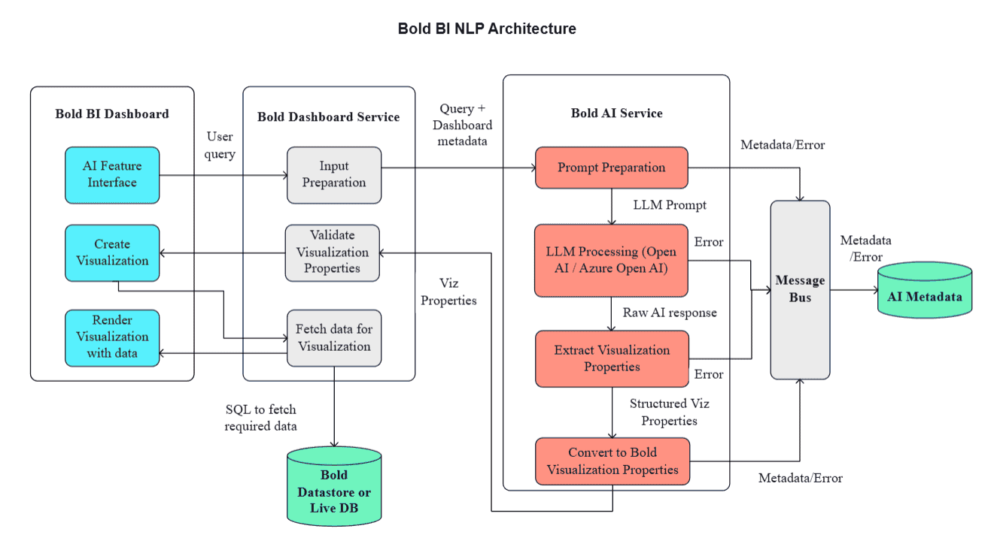
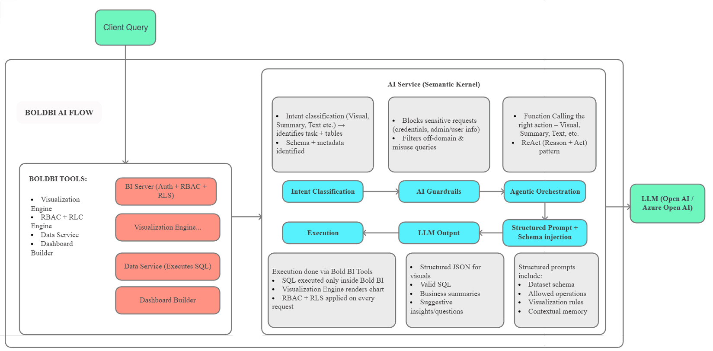
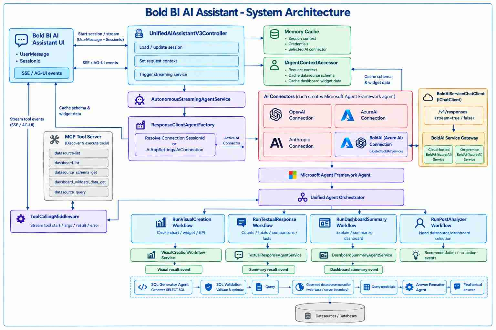

# Architecture of the AI Assistant in Bold BI

Bold BI incorporates a natural language processing (NLP) interface that enables users to interact with business intelligence data using plain english queries. This capability supports the generation of visualizations, textual summaries, business insights, and contextual responses directly within the platform.

The AI functionality in Bold BI is described through three complementary architectural perspectives:

1. **Bold BI NLP Architecture** 

-  Represents the complete, end-to-end process within the Bold BI application from user query submission through to the final rendering of visualizations in the dashboard.

2. **Bold BI AI Service Architecture** 

 - Describes the dedicated, AI service layer responsible for secure intent detection, governance, LLM orchestration, reasoning, guardrails, and structured output generation. This service powers the natural language capabilities across the Bold BI platform.

3. **Bold BI AI Assistant v3 Architecture**
 - Describes how the AI Assistant manages user sessions, retrieves datasource and dashboard context through MCP tools, integrates with multiple AI providers, processes user intent, orchestrates specialized workflows, and generates visualizations, insights, summaries, recommendations, and conversational responses.

## Bold BI NLP Architecture

This document outlines the process flow for using the AI feature within Bold BI to generate visualizations from user queries via natural language processing (NLP).

**1. AI Feature Interface**

- Users can interact with the AI feature interface to submit natural language queries.
- This interface allows users to request visualizations by describing their requirements in a simple query format.

**2. Input Preparation**

- Once a query is submitted, it is sent to the Bold Dashboard Service.
- The service prepares the input by combining the user's query with the datasource metadata which will include the customer datasource details such as Table names, columns and their data type.

**3. Prompt Creation**

- The prepared input (user query + datasource metadata) is then passed to the Bold AI Service for prompt creation.
- A prompt is formulated to contact the large language model (LLM) from OpenAI, requesting an AI-generated response based on the user's input.

**4. LLM Processing**

- The created prompt is processed by the selected LLM, which generates a raw AI response.
- This response contains potential data for visualization or appropriate response for the user's query.

**5. Extracting Visualization Properties**

- The raw AI response is then analyzed to extract visualization properties, which include information about the type of chart and fields to build the visualization.

**6. Converting to Bold BI Visualization Properties**

- The extracted visualization properties are converted into a format that is compatible with Bold BI.

**7. Validation of Visualization Properties**

- The converted visualization properties are validated to ensure they align with the data structure and user preferences.

**8. Data Fetching**

- Once the visualization properties are validated, the required data is fetched from the Bold Datastore or a Live Database.
- An SQL query is generated to retrieve the relevant data for the requested visualization.

**9. Creating and Rendering Visualizations**

- The visualization is created based on the retrieved data and the validated properties.
- Finally, the Bold BI Dashboard renders the visualization, which the user can interact with or further customize its properties.

## Bold BI AI Service Architecture

This document describes Bold BI's secure, governed AI Service architecture, an intelligent backend that processes natural language queries through semantic understanding, enforces strict access controls, leverages advanced LLM reasoning, orchestrates Agentic workflows, and executes entirely within the Bold BI platform.

**1. Client Query**

- The entry point of the architecture where users submit their queries. 
- This serves as the initial input that triggers the entire Bold BI AI flow, directing the query into the semantic kernel for processing.

**2. BI Server (Auth + RBAC + RLS)**

- A core component of the Bold BI platform that manages authentication, role-based access control (RBAC), and row-level security (RLS). 
- It ensures secure access to data and applies permissions on every request, integrating with visualization, data services, and dashboard building.

 **3. Intent Classification**

- This module analyzes the client query to determine its intent, such as requests for visuals, summaries, or text-based outputs. 
- It identifies relevant tasks, tables, schema, and metadata, while blocking sensitive requests involving credentials or admin/user information.

**4. AI Guardrails**

- A protective layer that filters out off-domain queries and potential misuse. 
- It enforces compliance by rejecting inappropriate or unauthorized requests, ensuring the system remains secure and focused on valid business intelligence operations.

**5. Agentic Orchestration**

- Responsible for coordinating actions based on the classified intent, including function calling for appropriate responses like visuals, summaries, or text. 
- It employs the ReAct (Reason + Act) pattern to iteratively reason and execute steps, orchestrating the flow toward the LLM.
**6. Structured Prompt + Schema Injection**

- This prepares inputs for the LLM by injecting structured prompts that include dataset schemas, allowed operations, visualization rules, and contextual memory. 
- It ensures the LLM generates accurate, context-aware responses aligned with the system's constraints and user needs.

**7. LLM Output**

- The output generated by the Large Language Model (LLM), such as Open AI or Azure Open AI. 
-  It produces structured results like JSON for visuals, valid SQL queries, business summaries, and suggestive insights or questions to enhance user interaction.

**8. Execution**

- Handles the actual processing of queries through BOLD BI Tools. 
- This includes executing SQL only within the secure Bold BI environment, rendering charts via the Visualization Engine, and applying RBAC + RLS on every request to maintain data integrity and security.

## Bold BI AI Assistant v3 Service Architecture

This section describes Bold BI AI v3, an advanced service architecture that improves upon the previous version by streamlining user interactions, supporting multiple AI providers, and enabling flexible deployment options.

**1. User Interface & Session Handling**

- The AI Assistant UI sends user messages and session IDs to the Bold BI service.
- The server retrieves the session information from cache, which includes user credentials, the selected AI provider, and previous context about datasources and dashboards.

**2. Request Processing**

- The Bold BI platform receives the user query and initializes the orchestration service to process the request.
- The service manages real-time communication with the user interface, providing streaming responses as they are generated.

**3. AI Provider Selection**

- Bold BI v3 supports multiple AI providers through a unified connector system:
  - **OpenAI** - Direct integration with OpenAI's models
  - **Azure OpenAI** - For enterprise deployments on Azure
  - **Anthropic Claude** - Alternative AI models
  - **Bold BI AI Service** – Azure-hosted service gateway for cloud or on-premises deployments.

**4. Session & Context Management**

- The system retrieves and caches important information including:
  - User session data and credentials
  - Connected datasource metadata (table names, columns, data types)
  - Dashboard widget information
  - User permissions and security settings

**5. Data Discovery & Context**

- The AI Assistant uses MCP tools to discover and retrieve:
  - Available datasource schemas and metadata
  - Dashboard widget structures and data
  - Query execution capabilities
  - Business context and relationships

**6. Query Processing & Intent Recognition**

- The system analyzes the user's query to determine the intent (create a visualization, provide text analysis, summarize a dashboard, or provide recommendations).
- Based on the identified intent, the appropriate workflow is selected.

**7. Workflow Execution**

- Depending on the query intent, the system executes specialized workflows:
  - **Visual Creation** - Generates charts, widgets, and KPIs from user queries
  - **Text Response** - Provides textual analysis, aggregations, and comparisons
  - **Dashboard Summary** - Creates summaries that highlight key insights from dashboards
  - **Recommendations** - Suggests follow-up questions and next steps for analysis

**14. Specialized Workflow Services**

Each workflow invoked by the Unified Agent Orchestrator delegates to a dedicated service:

- **Visual Creation Workflow Service** — processes visual creation requests and emits a **Visual result event** back to the UI.
- **Textual Response Agent Service** — the system generates SQL queries based on the user's intent and the datasource schema. Queries are validated to ensure security and accuracy. The data is fetched from the connected datasources
- **Dashboard Summary Agent Service** — processes dashboard summarization requests and emits a **Dashboard summary event**.
- **Run Post Analyzer Workflow** — evaluates whether a datasource or dashboard selection is needed and emits **Recommendation / no-action events** directly, without a dedicated downstream service.

**9. Security & Access Control**

- All queries execute within the secure Bold BI environment.
- Row-level security (RLS) and role-based access control (RBAC) are enforced on every request.
- User permissions are applied to ensure data confidentiality and compliance.