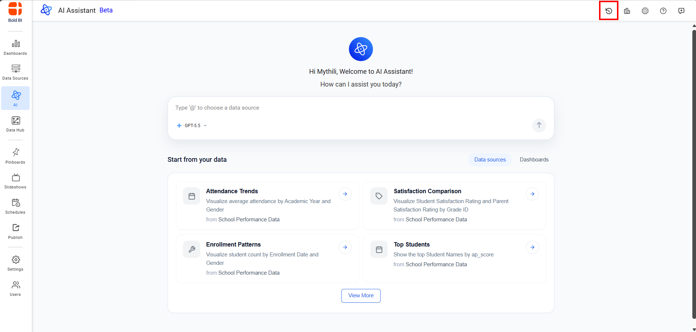
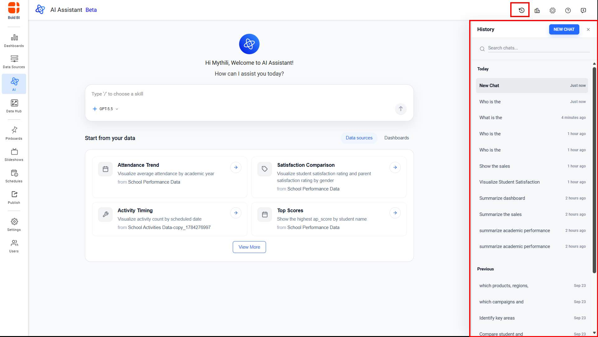
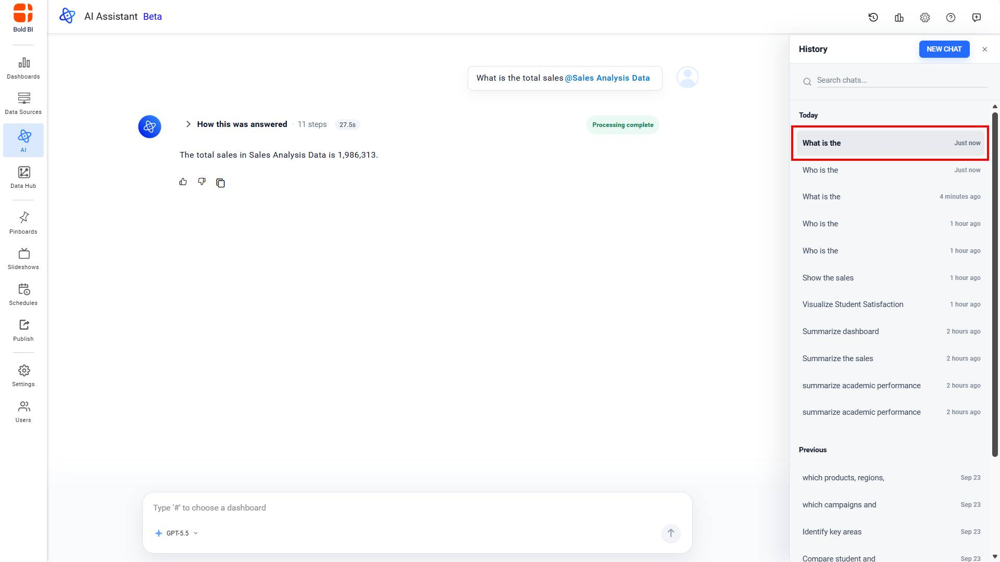
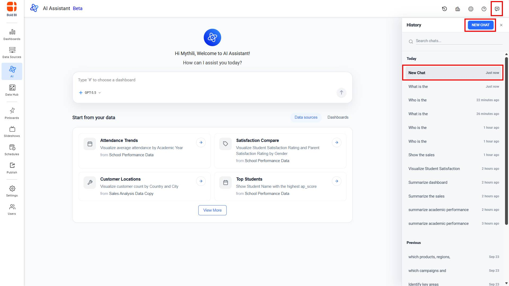
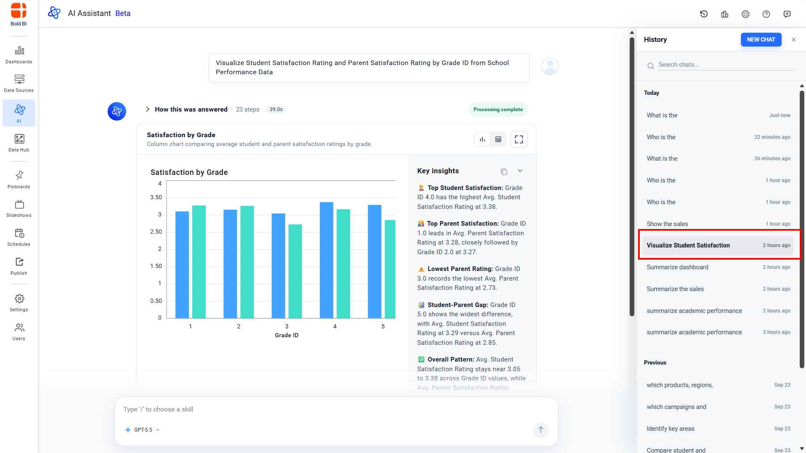
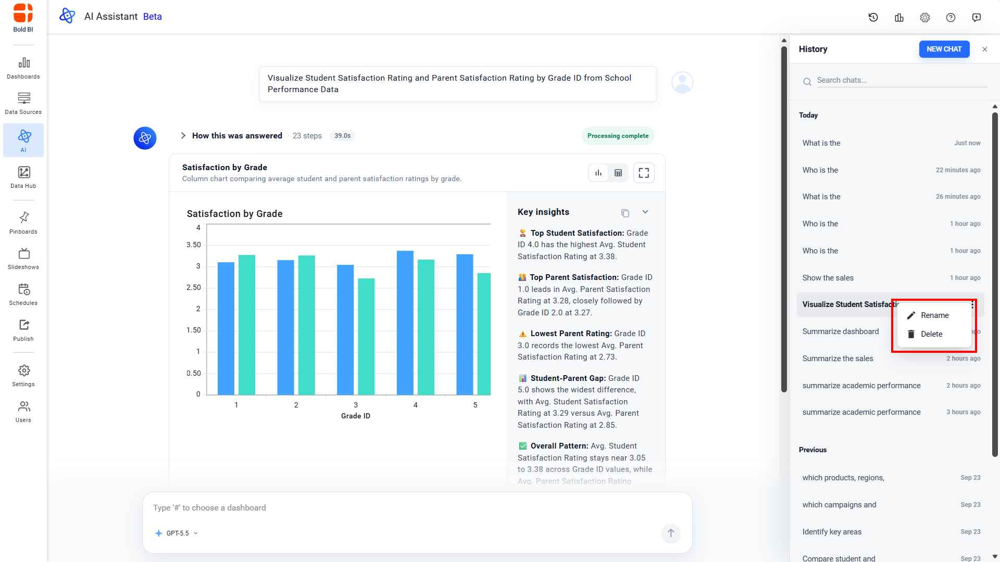

# View and Resume Chat History in Unified AI

We have introduced a **chat history** feature in the **AI Assistant** to seamlessly maintain, organize, and track all your conversation sessions. This powerful capability ensures continuity across interactions, allowing you to effortlessly review past queries and responses, switch between multiple active sessions, resume work exactly where you left off, and maintain full context ideal for complex workflows, iterative analysis, or long-running projects. With this feature, you can:

- Automatically save every session as you work  
- Easily switch between multiple ongoing analyses  
- Revisit past queries and generated outputs at any time  
- Maintain context across different dashboards or data sources  
- Resume interrupted workflows without losing progress

## How to Use Chat History

1. Click the clock icon in the top-right corner.

2. The history panel opens, showing your current session at the top.

3. Enter your queries. All messages are saved with the session and appear in the history panel. 

4. Click the new chat icon to start a new session. The current one is saved. 
 

5. Click any past session in the panel to open and continue it.

6. You can delete or rename any session.

> **Note:** Widget summary support is not preserved when loading past sessions. However, any new visuals created in a loaded session will include their respective summaries.
