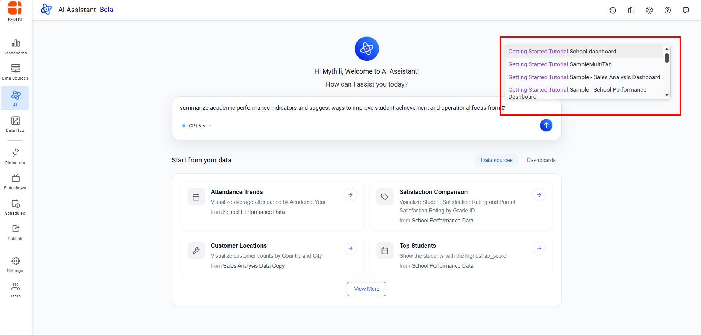
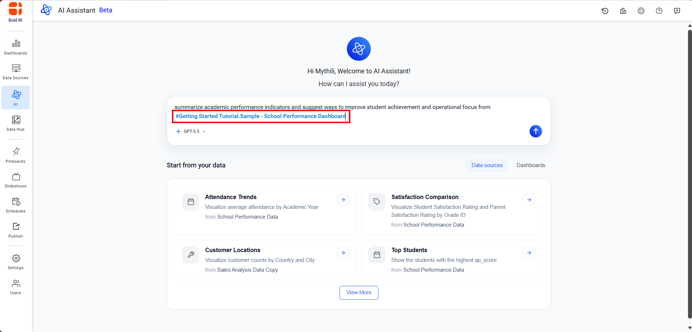
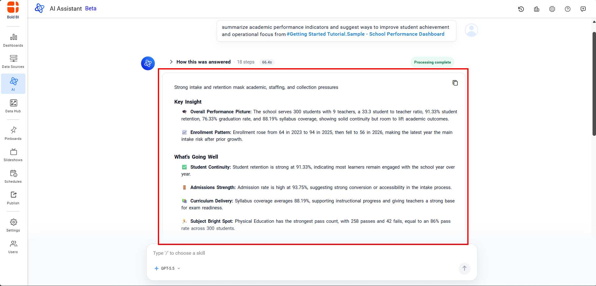
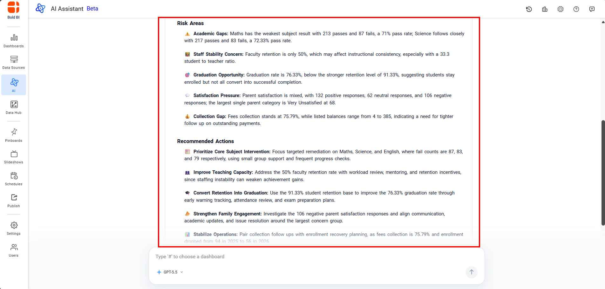
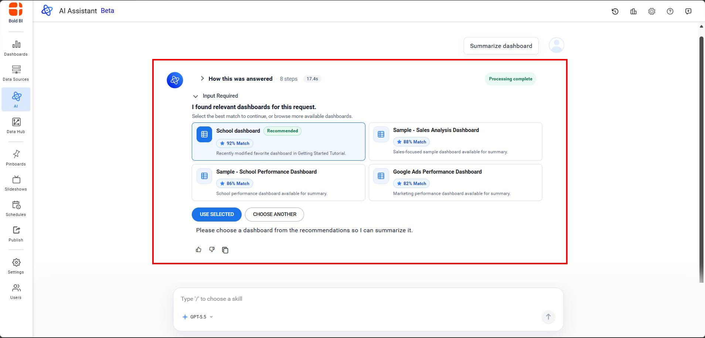
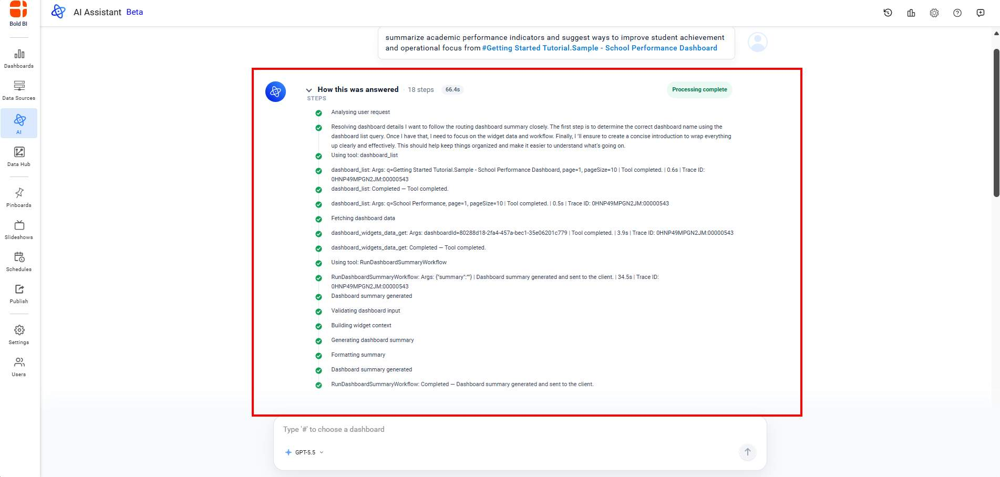

# Dashboard Summary Feature in Unified AI
In Dashboard mode, the AI Assistant delivers brief summaries of dashboards, emphasizing key trends and insights. Select **Dashboard** from the dropdown menu to view the suggestions.

## Dashboard Summary
The AI Assistant can analyze a dashboard and provide a summarized overview of its key metrics and insights. The summary is generated in real-time streaming mode, allowing you to see the response being generated as it's created.

### Steps to Generate a Dashboard Summary

1. Type the `#` symbol in the chat input to view the list of available dashboards.

2. Select a required dashboard from the list to continue your query.

3. The available AI models are displayed based on the configuration used in the Site Settings page. Select a model to continue your query. By default, the latest available model is automatically selected.

4. Send your query to generate a summary.

5. If you do not manually select a dashboard, the AI Assistant automatically retrieves available dashboards, identifies the most relevant dashboard based on your query, suggests alternatives when multiple matches are found, and generates a dashboard summary in streaming mode.

6. Each dashboard summary includes a collapsible **"How this was answered"** section that provides transparency into the AI Assistant's reasoning process. You can click to expand the collapsible section to see all reasoning steps and tool calls.

>**Note**: Users can submit queries only for dashboards to which they have access permissions.

