# Data Features Overview in Unified AI Agent
In Data mode, AI Assistant enables users to query connected data sources to generate either visualizations or textual responses. This mode can be accessed by selecting the **Data sources** option from the dropdown menu within the AI Assistant interface.

## Visual Generation
The AI Assistant generates visuals in response to user queries by utilizing data from connected data sources. Responses are generated in real-time streaming mode, allowing you to see the visual and summarization being created as it's generated.

**Steps to Generate a visual**:
1. Ask a query to create a visual.

2. Type the `@` symbol to view the list of available data sources and manually select one.
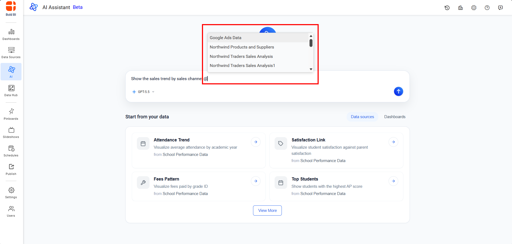

3. Select a required datasource from the list to continue the query.
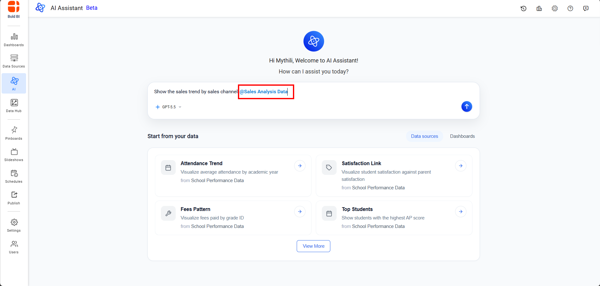

4. If you do not manually select a datasource, the AI Assistant automatically retrieves all available data sources, identifies the most relevant datasource based on your query, and suggests alternatives if multiple datasources match.

5. The available AI models are listed based on the configuration defined in the Site Settings page. Select a model to continue your query. By default, the latest available model is automatically selected.
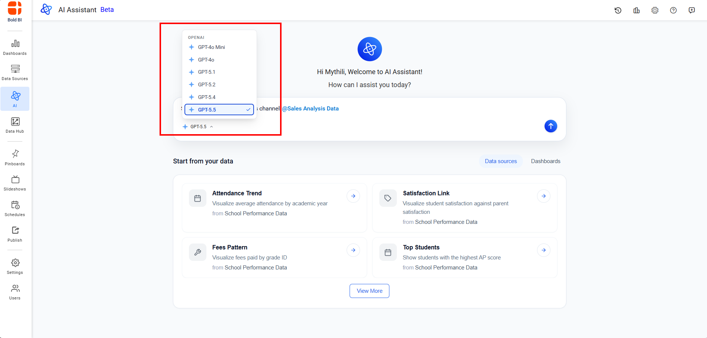

6. Send the query to generate the visual. The visual renders in streaming mode, displaying the chart or visualization as it's being created. Once the visual renders, a widget summarization is automatically generated in streaming mode to provide key insights about the data displayed.
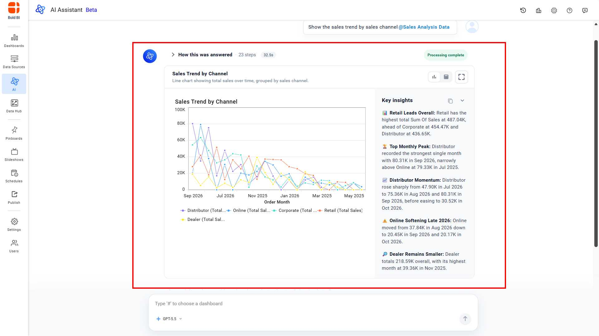

7. Click the **Maximize** button on top-right corner of the widget to view the widget in full-screen mode for better visibility.
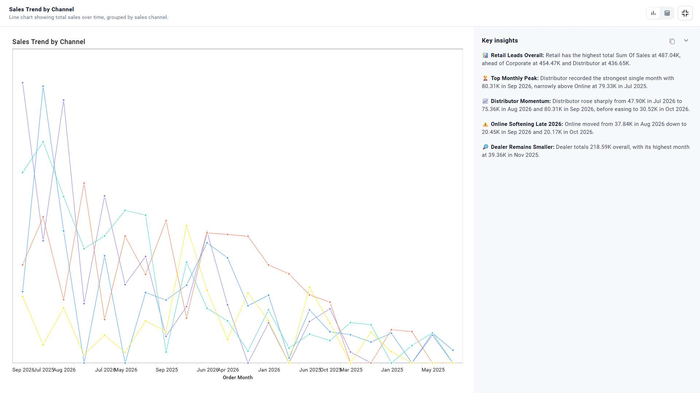

8. Each response includes a collapsible **"How this was answered"** section that provides transparency into the AI Assistant's reasoning process. You can click to expand the collapsible section to see all reasoning steps and tool calls.
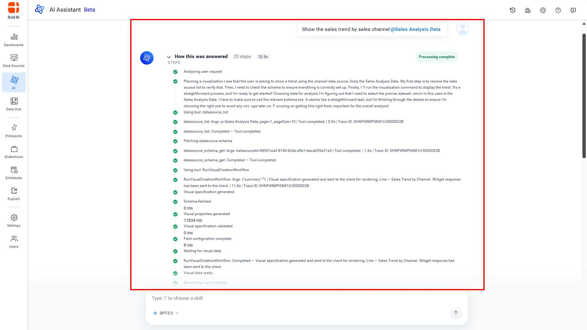

## Skills

Skills extend the AI Assistant's capabilities by providing reusable instructions and enabling MCP tool integration for improved response quality. Built-in skills are added by Bold BI and custom skills created by administrators. For more details, refer to the [Skills](/artificial-intelligence-and-machine-learning/unified-ai-agent/settings/skills/) page.

**Steps to Select and Use Skills**:
1. Type the `/` symbol in the chat input to view the list of available skills.

2. The list displays both built-in skills and custom skills. Select a required skill from the list and ask your query.
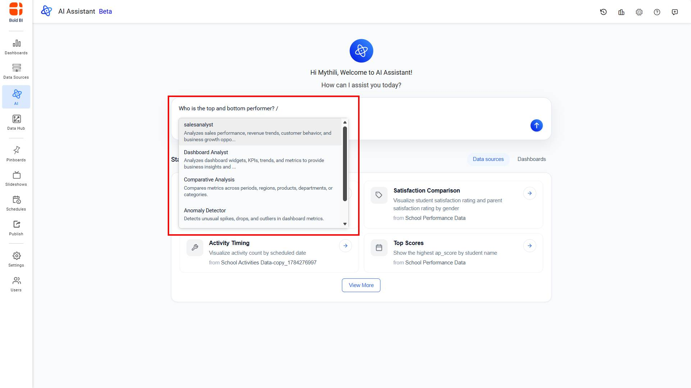

3. Select a required skills from the list to continue the query.
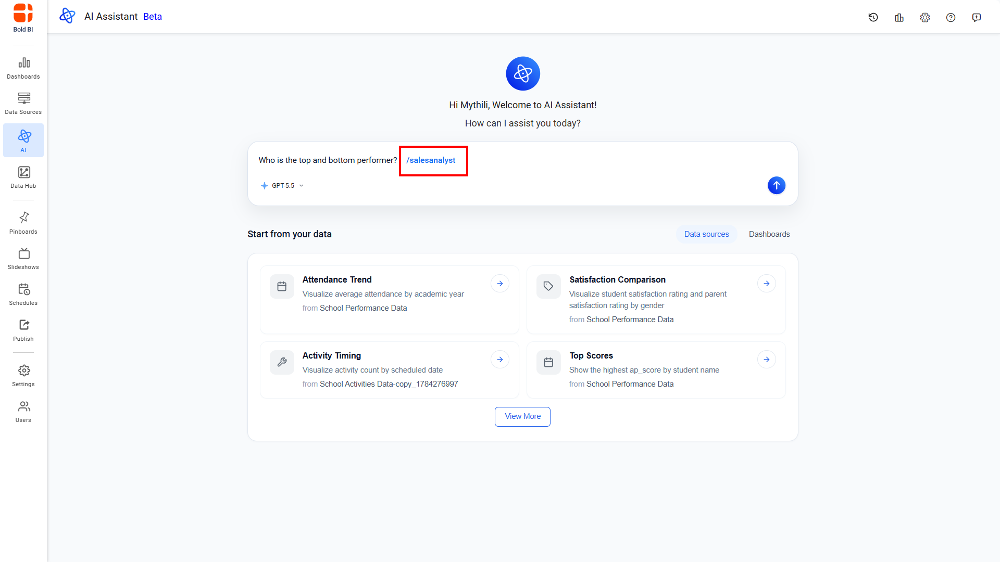

4. Send your query to generate the response with the selected skill.
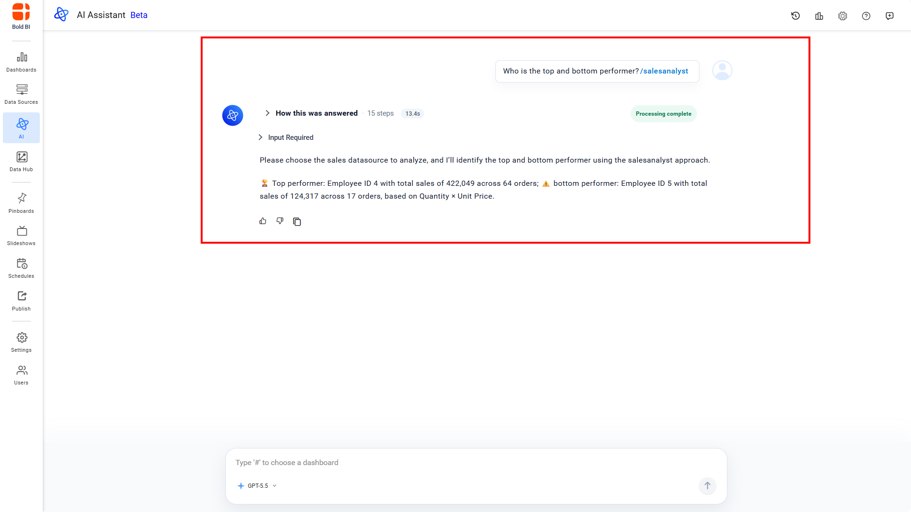

>**Note**: Built-in skills are provided by Bold BI, while custom skills are created and managed by administrators in the AI Assistant Settings.

## Text-Based Response
AI Assistant can provide detailed textual answers based on your data sources, ideal for quick insights without visualizations. Responses are generated in real-time streaming mode for immediate feedback.

**Steps for Text-Based Response**:
1. Ask a query for a textual response.

2. Type the `@` symbol to view the list of available data sources and manually select one.
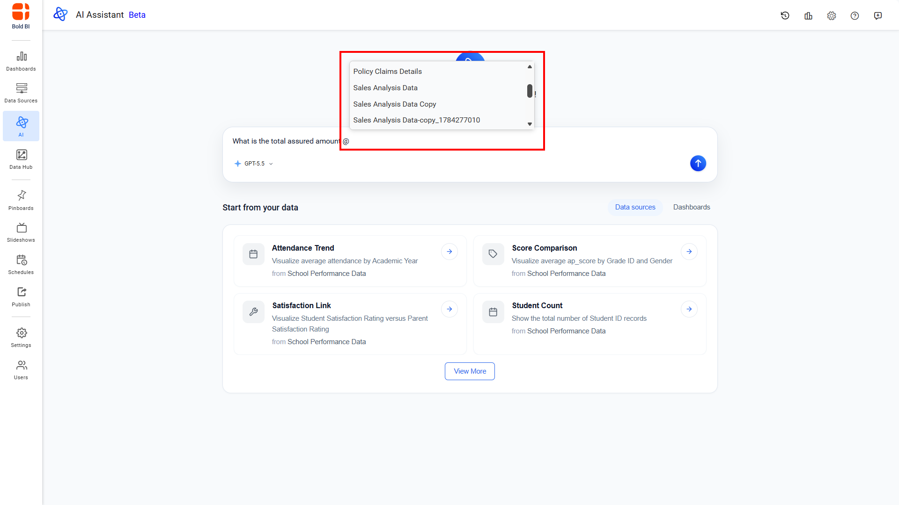

4. Select a required datasource from the list to continue the query
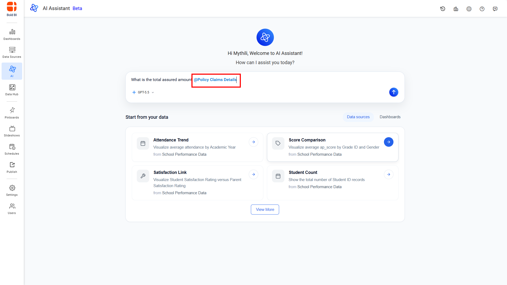

3. If you do not manually select a datasource, the AI Assistant automatically retrieves all available data sources, identifies the most relevant datasource based on your query, and suggests alternatives if multiple datasources match.

5. The available AI models are displayed based on the configuration defined in the Site Settings page. Select a model to continue your query. By default, the latest available model is automatically selected.
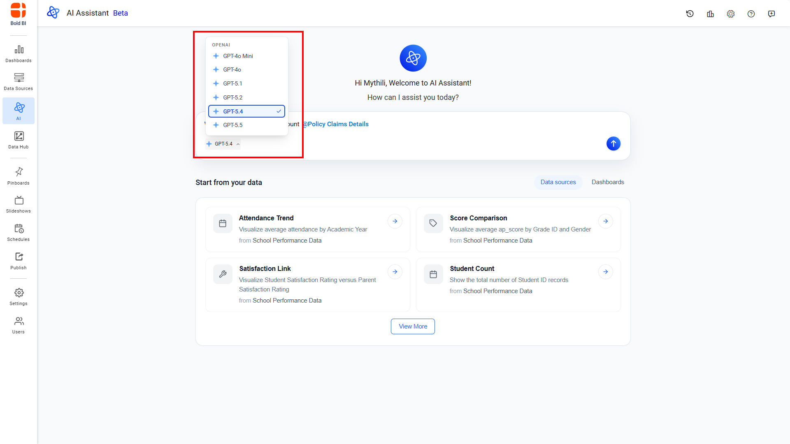

6. Send the query to receive a textual response in streaming mode.
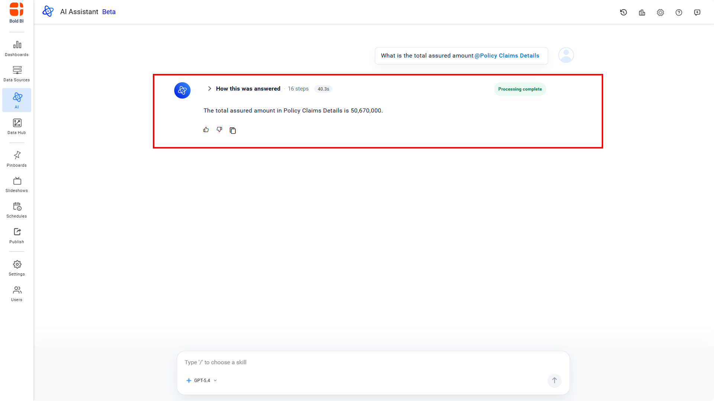

7. Each response includes a collapsible **"How this was answered"** section that provides transparency into the AI Assistant's reasoning process. You can click to expand the collapsible section to see all reasoning steps and tool calls.
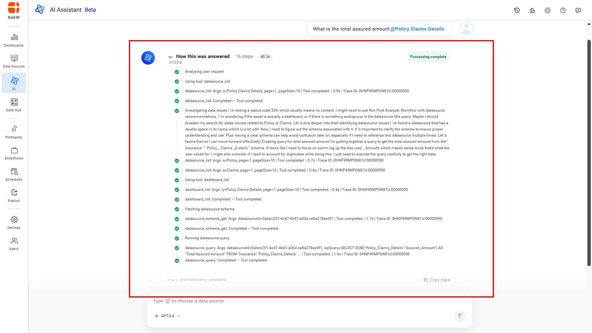

>**Note**: Users can submit queries only for data sources to which they have access permissions.

## Toggling Widget Types

The AI Assistant enables seamless switching between chart and grid views for any AI-generated widget. The initial view is automatically determined by the AI in accordance with your query. Upon the first toggle, the alternate view is likewise generated by the AI. Once both views have been created, subsequent switches occur instantaneously, without invoking the AI again, by reusing the previously generated data and rendering it in the selected format.

**Steps to Toggle a Widget**

1. Locate the toggle icon in the top-right corner of the widget.
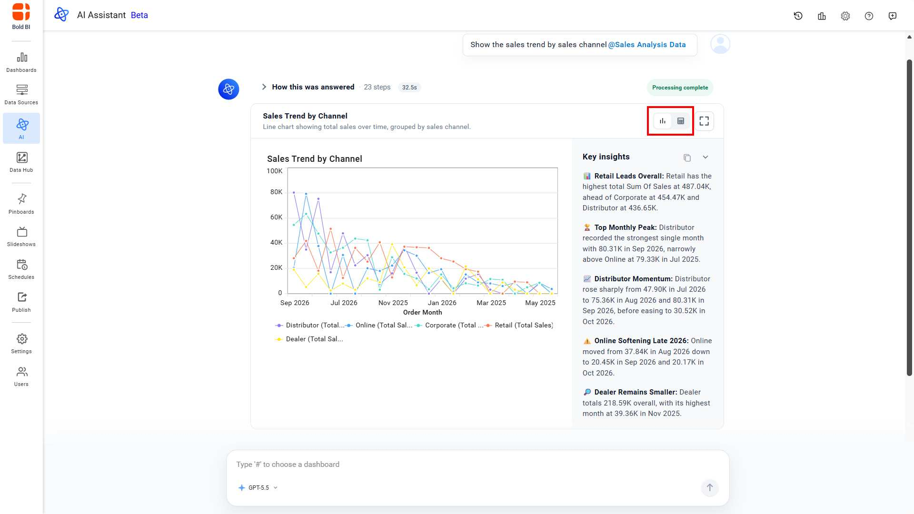
2. Click the opposite side of the switch to change the view.
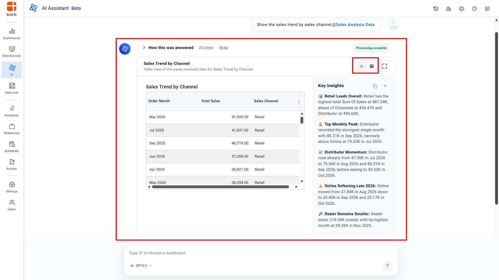

> **Note:** Enable summarization in **UMS** or **Site Settings** to use this feature.