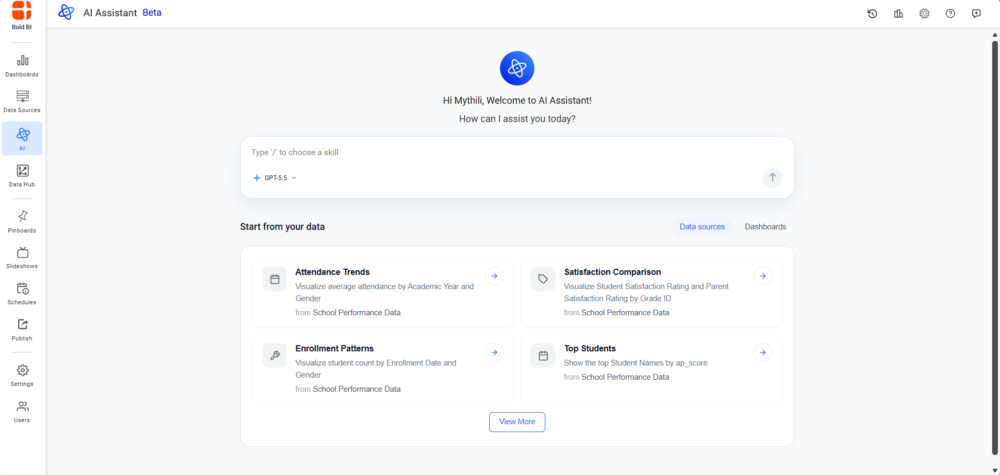
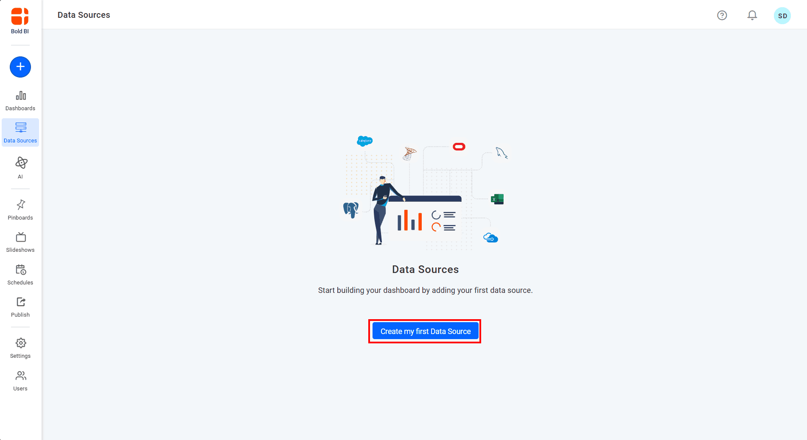
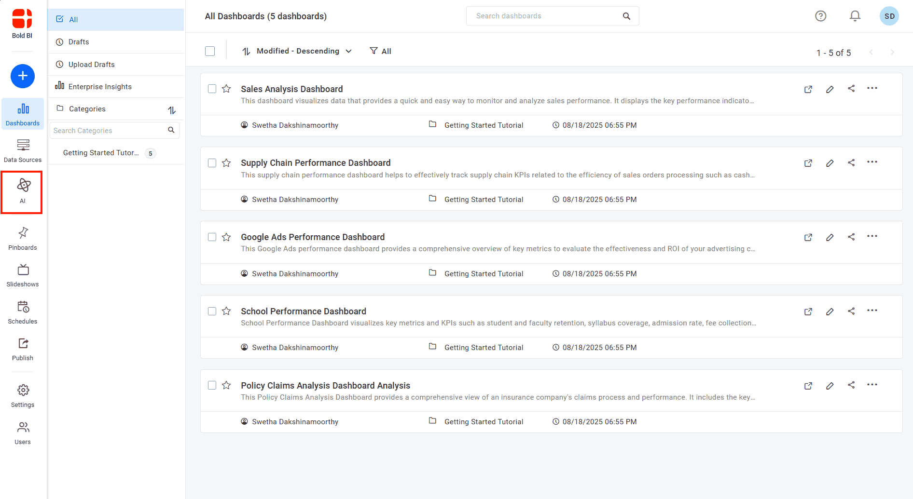
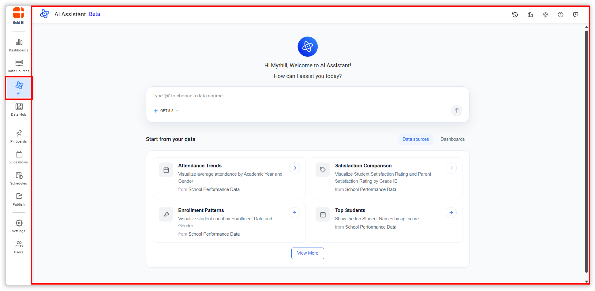
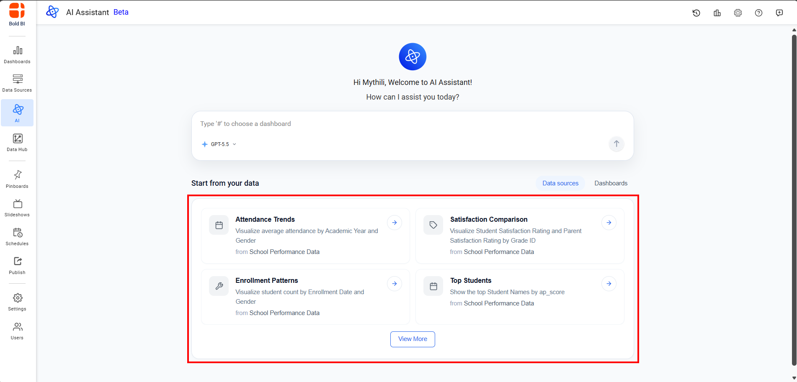
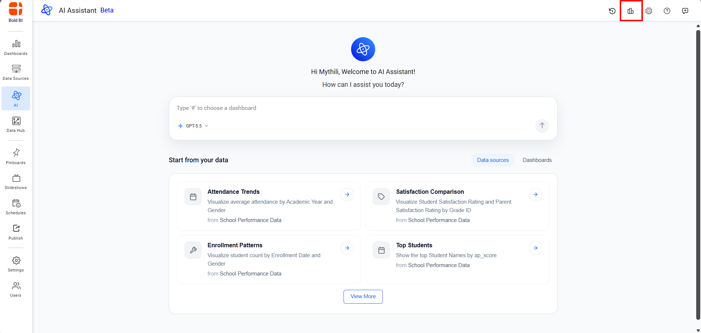
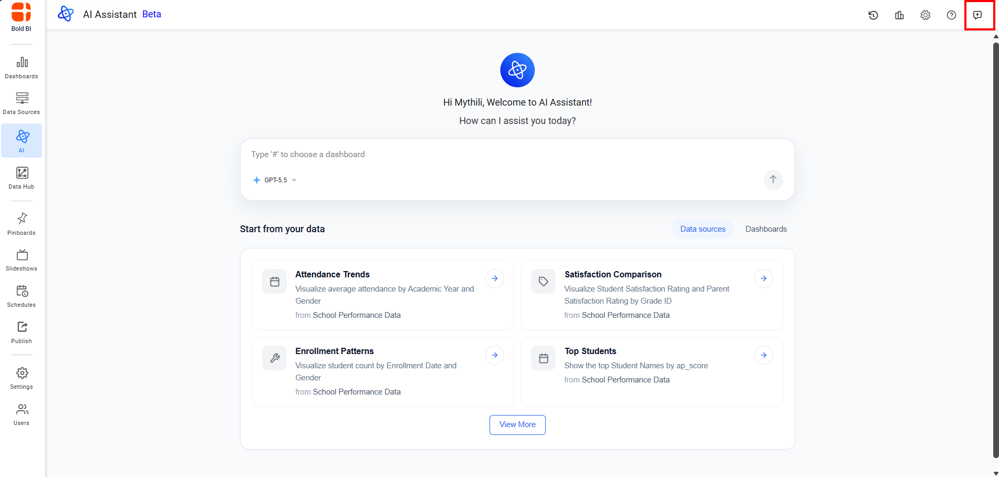
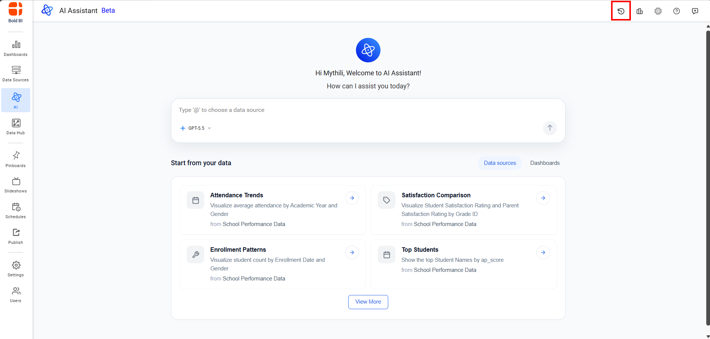
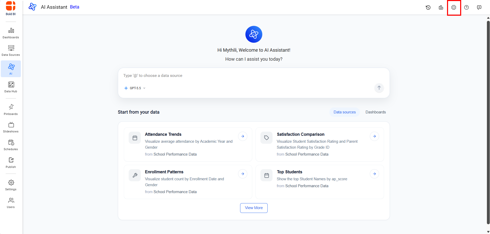
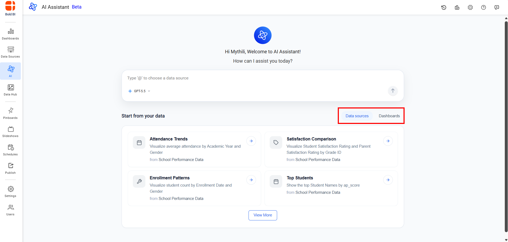

# AI Assistant

## Getting Started with AI Assistant
AI Assistant in Bold BI, powered by Large Language Models (LLMs), improves analytical workflows by enabling users to perform text-based queries on integrated data sources, automatically generate visual widgets from input, and create concise dashboard summaries that clearly highlight important insights.

## Configuring AI Assistant
During the installation of Bold BI, a license key update screen will be displayed. Entering a valid license key at this stage will automatically activate the AI service. If this step is missed, the AI service can still be activated later by accessing the "Manage License" section on the UMS page.

## Adding a Data Source
To ask questions or create visualizations with AI Assistant, you need to connect a data source:

1. Navigate to the **Data Source** in Bold BI.

2. Click Create Data Source to add and connect your data.

3. Once added, you can explore the data source with suggested questions and add it to your query in AI Assistant by typing @ followed by the data source name.

## Accessing AI Assistant
Follow these steps to start using AI Assistant:

1. Click the **AI** option in the left-side panel of Bold BI.

2. AI Assistant Agent will be opened with a new session.

3. Use the sample suggestion list provided below to design a visual or textual representation

4. Click the usage icon to view detailed usage information. For additional information, please refer to the guide [Usage](/artificial-intelligence-and-machine-learning/unified-ai-agent/settings/usage/)

5. Click the restart icon to begin a new session.

6. Click History icon to view and resume any saved session. For additional information, please refer to the guide [Chat History](/artificial-intelligence-and-machine-learning/unified-ai-agent/chat-history/)

7. Click Settings icon to access AI Assistant configuration options. For more details, refer to the [Settings](/artificial-intelligence-and-machine-learning/unified-ai-agent/settings/) page.

## Data and Dashboard Features

AI Assistant in Bold BI empowers users to interact with data and dashboards through a conversational interface. It supports two primary modes: **Data** and **Dashboard**. In **Data** mode, users can generate widgets or receive text-based responses by querying connected data sources. In **Dashboard** mode, users can generate summaries of dashboards to uncover key insights.

Additionally, AI Assistant integrates **Chat History**, enabling you to review past interactions, switch sessions, and resume analysis seamlessly—ensuring continuity across workflows and dashboards.

## User Features

The following sections explain how to use each feature:

[Data](/artificial-intelligence-and-machine-learning/unified-ai-agent/data/)  
[Dashboard](/artificial-intelligence-and-machine-learning/unified-ai-agent/dashboard/)  
[Chat History](/artificial-intelligence-and-machine-learning/unified-ai-agent/chat-history/)
[Settings](/artificial-intelligence-and-machine-learning/unified-ai-agent/settings/)