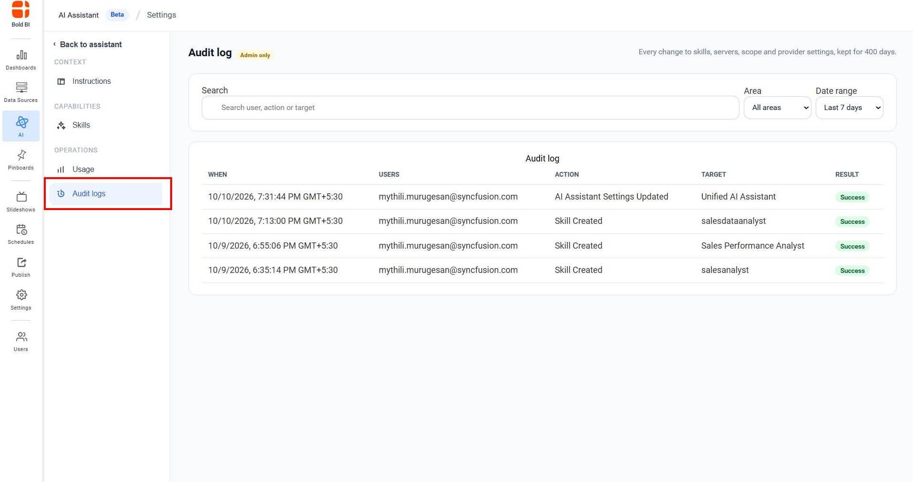

# Audit Logs

Audit Logs track all changes to AI Assistant settings and skills. This provides a complete history of who made changes, when they were made, and what was changed.

## Accessing Audit Logs

1. Navigate to AI Assistant → Settings → Audit logs.   
2. Click **Audit logs** in the left sidebar under **OPERATIONS**.

> **Note**: Only administrators can access audit logs.

## What is Tracked

Audit logs record changes to:

- Skills (creation, editing, deletion, enable, disable)
- Global Instructions (creation, modification, deletion)

## Audit Log Information

Each log entry shows:

- **WHEN** - Date and time of the change
- **USERS** - Administrator email who made the change
- **ACTION** - What was done (Skill Created, Settings Updated, etc.)
- **TARGET** - What was affected (skill name, instructions, etc.)
- **RESULT** - Whether it succeeded or failed

## Searching Audit Logs

1. Use the **Search** box to find specific changes by entering:
   - User email
   - Action type
   - Target resource name

2. Use **Date range** to filter by time period:
   - Last 7 days (default)
   - Other options available

3. Use **Area** dropdown to filter by category:
   - Skill
   - MCP server
   - AI provider
   - Assistant settings
   - Agent
   - Permission
   - Other areas
