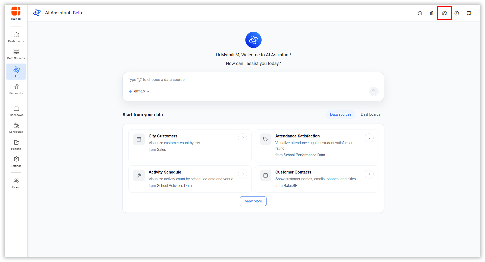
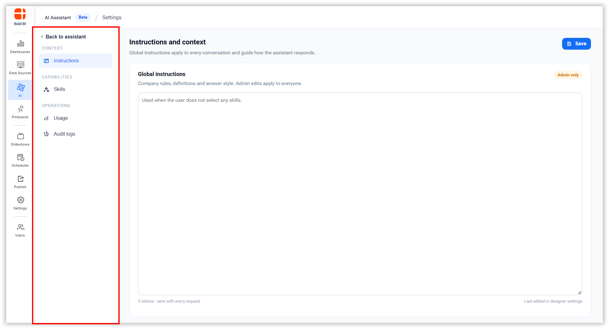
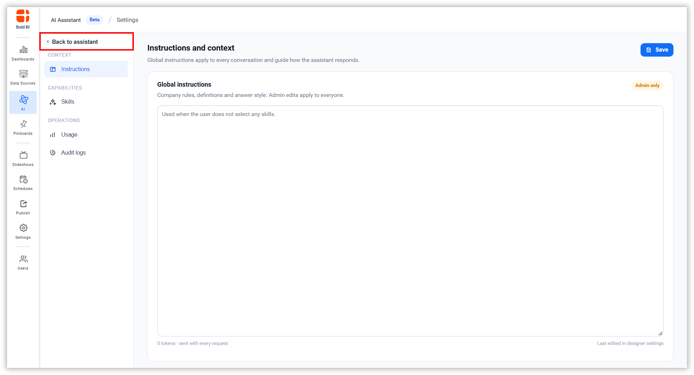

# AI Assistant Settings

AI Assistant Settings allows administrators to configure how AI Assistant behaves, manage capabilities through skills, monitor usage, and track all administrative changes.

## Accessing Settings

1. Click the **Settings** icon in the top-right corner.

2. The left sidebar shows configuration options.

3. Click **Back to Assistant** to return to the AI Assistant interaction page.

## Settings Sections

**Instructions** - Set global guidelines that AI Assistant follows for all interactions.

**Skills** - Extend AI Assistant capabilities by creating and managing reusable skills with custom instructions.

**Usage** - Monitor how AI Assistant is being used, track token consumption, and view active users.

**Audit logs** - Review all administrative changes made to AI Assistant settings.

The following sections explain how to use each feature:

[Instructions](/artificial-intelligence-and-machine-learning/unified-ai-agent/settings/instructions/)  
[Skills](/artificial-intelligence-and-machine-learning/unified-ai-agent/settings/skills/)  
[Usage](/artificial-intelligence-and-machine-learning/unified-ai-agent/settings/usage/)  
[Audit logs](/artificial-intelligence-and-machine-learning/unified-ai-agent/settings/audit-logs/)
