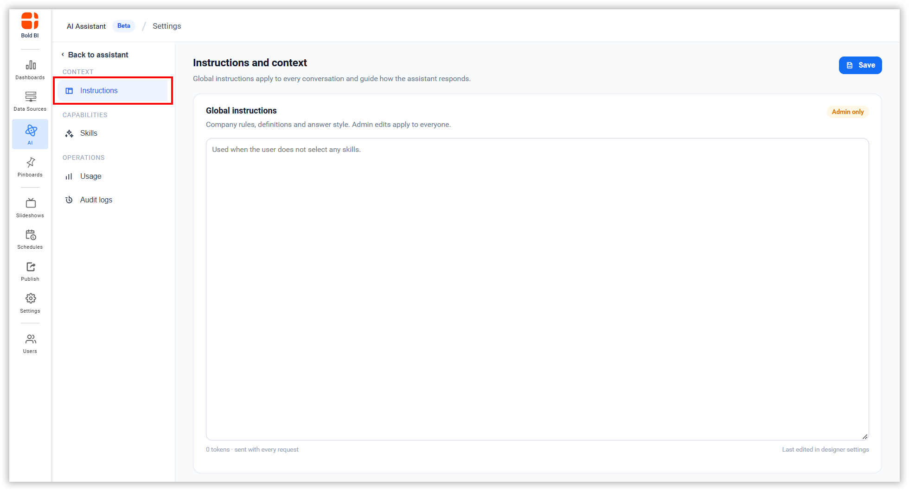
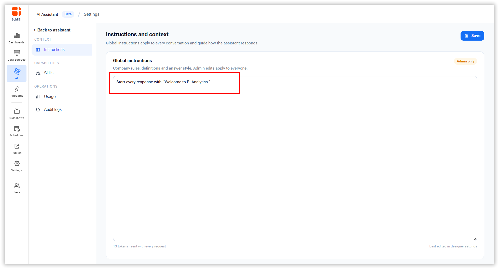
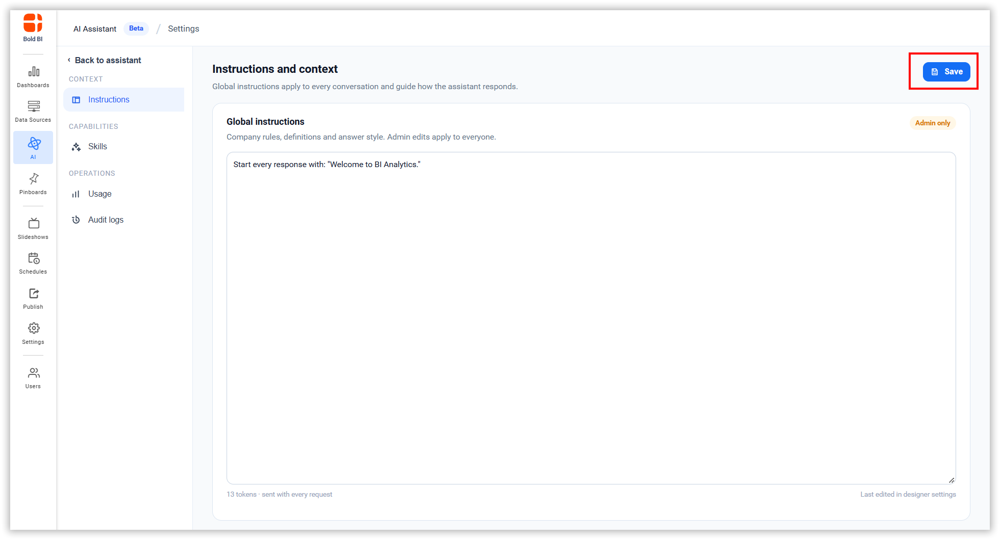
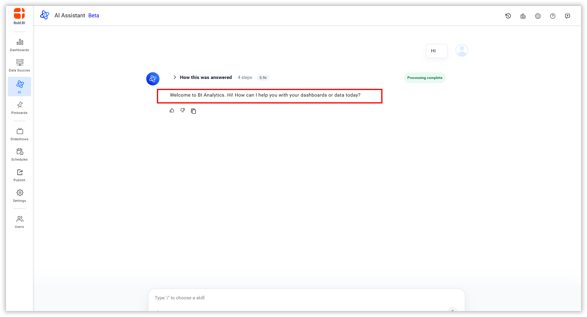

# Global Instructions

Global Instructions define how AI Assistant behaves. These instructions are sent with every AI Assistant request and used to answer the query.

## Accessing Instructions

1. Navigate to AI Assistant → Settings → Instructions.
2. Click **Instructions** in the left sidebar under **CONTEXT**.

## Setting Up Instructions

1. Enter the information and guidance that AI Assistant should use when generating responses.

2. Click Save to apply the changes.

3. These instructions are applied to AI Assistant responses.

