# Skills

Skills are specialized instruction sets that extend AI Assistant capabilities. Each skill combines custom instructions with MCP tools to provide focused, context-aware responses for specific business domains.

## Accessing Skills

1. Click the **Settings** icon in the top-right corner.
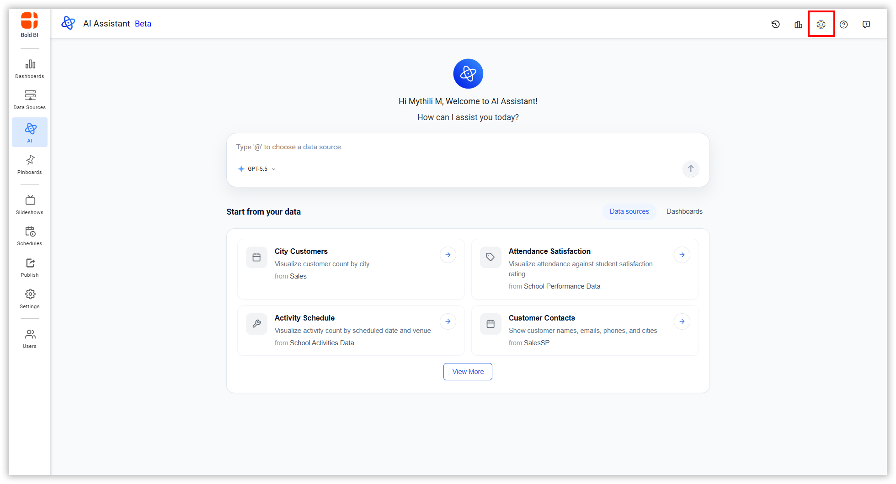

2. Click **Skills** in the left sidebar under **CAPABILITIES**.
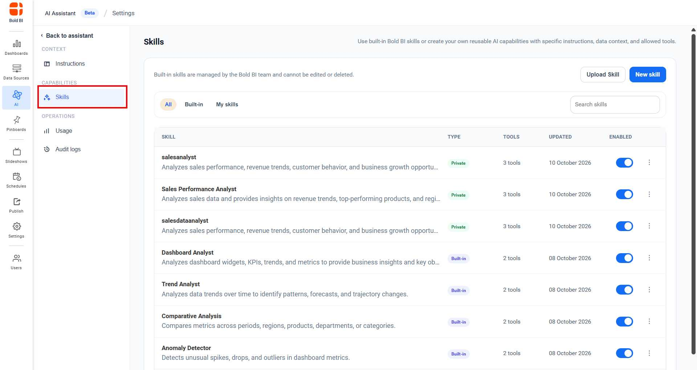

## Viewing Skills

The Skills page allows users to view and manage the skills available in AI Assistant. Skills are organized into the following categories:

- **All** - Displays both built-in skills and administrator-created skills in a single list.
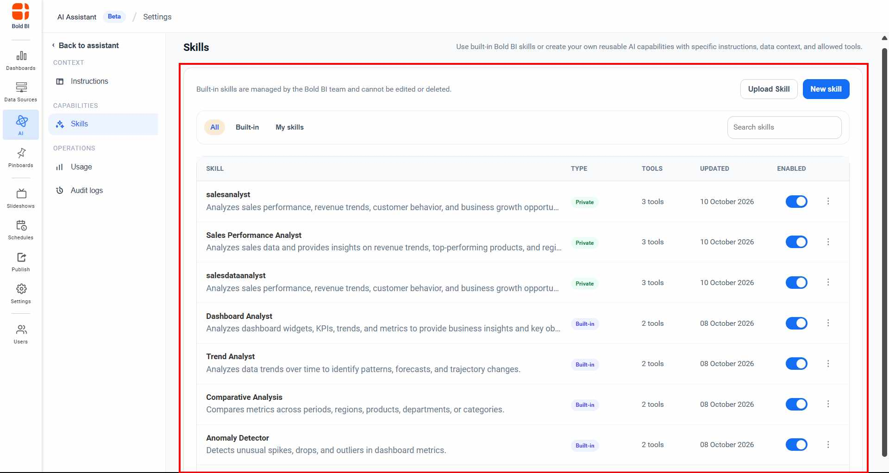

- **Built-in Skills** - Displays the predefined skills provided by Bold BI. By default, four built-in skills are available and are managed by the Bold BI AI team.
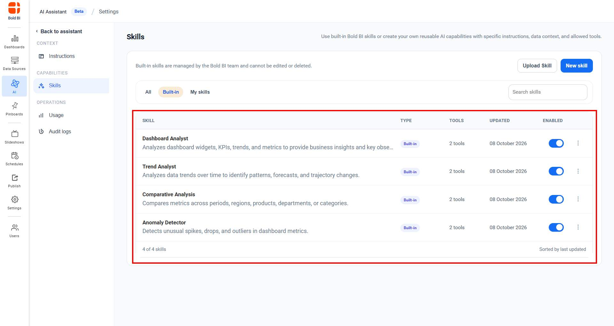

- **My Skills** - Displays custom skills created by administrators.
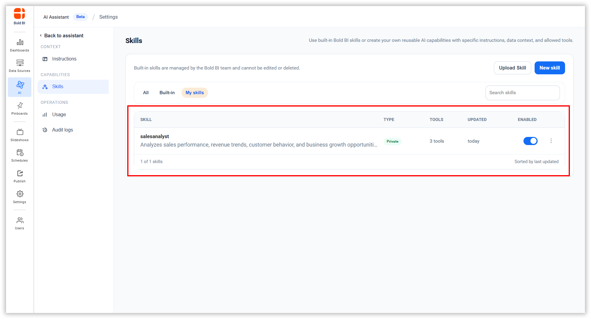

Users can browse, search, and manage skills based on their permissions.

## Creating a Skill

1. Click **New Skill** to create a new skill.
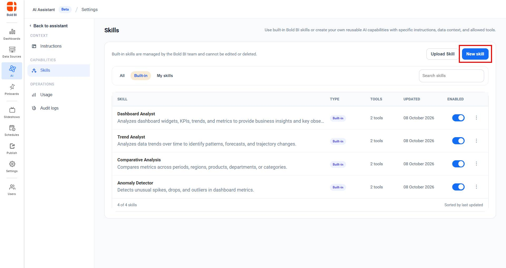

2. Enter the following details:
   - **Name** - Unique name for the skill
   - **Description** - What the skill does
   - **Status** - Enable or disable the skill
   - **Preferred MCP Tools** - Select the relevant MCP tools the skill should use when responding. To view the full list of available tools, refer to [Available MCP Tools](/mcp-integration/mcp-for-bold-bi-analytics/).
   - **Instructions** - Define the skill's role and behavior
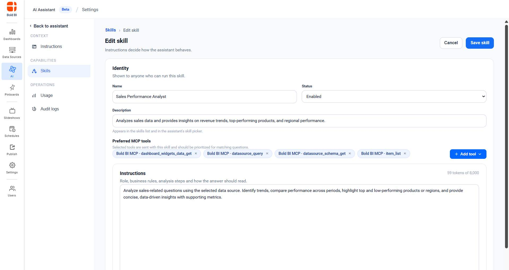

3. By default, four recommended MCP tools are selected to help the skill provide better results. To add more tools, click **Add Tool**. A list of available Bold BI MCP tools is displayed, allowing you to select tools that match your requirements. You can also remove any selected tool if it is not needed.
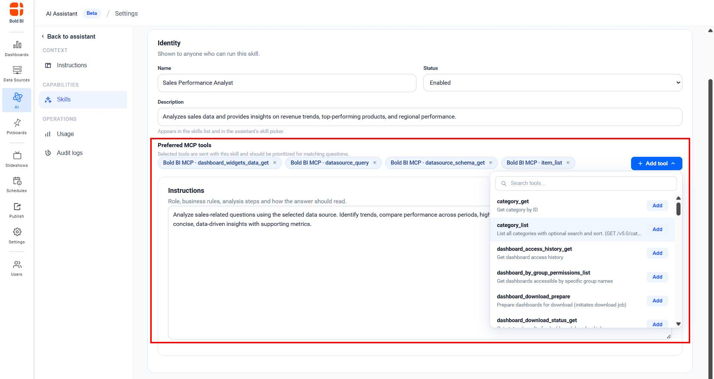

4. Click **Save Skill** to create the skill, or **Cancel** to discard the changes.
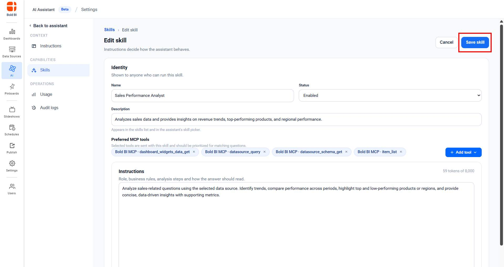

5. The created skills are listed in the skills page.
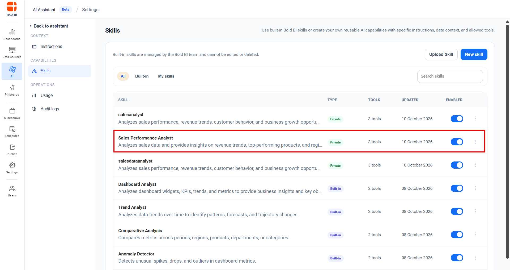

## Uploading a Skill

1. Click **Upload Skill** to add a new skill.
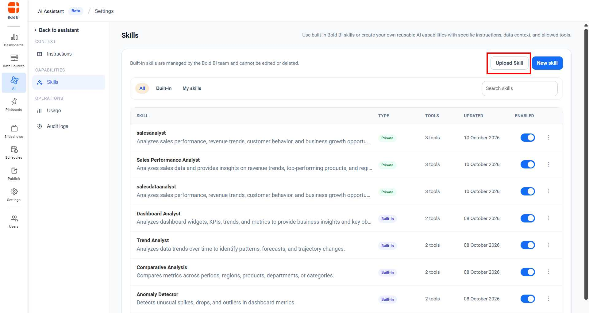

2. Select a markdown (`.md`) file containing skill metadata.
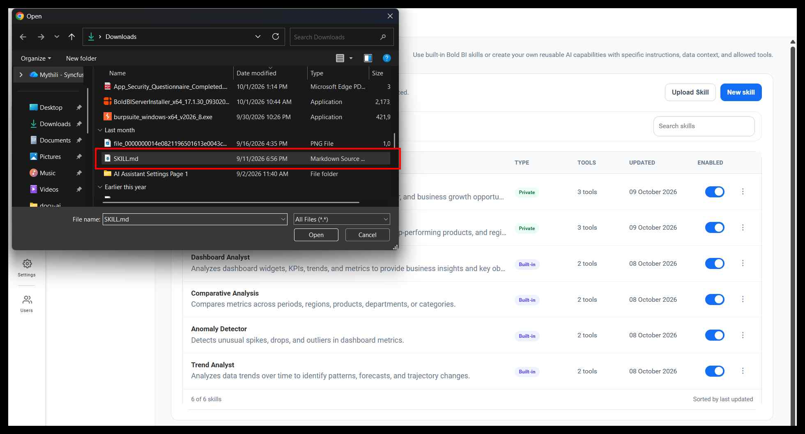

3. The skill information is auto-populated from the file.
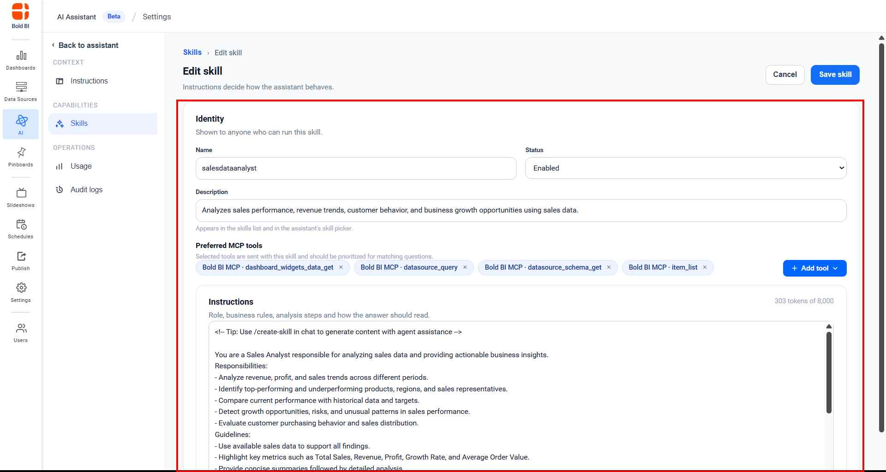

4. Click **Save Skill** to add the skill.

## Managing Skills

**Enable/Disable** - Toggle skill status on or off.
**View** - Click view icon to view skill details.
**Edit** - Click edit icon to modify skill details (custom skills only).
**Delete** - Remove a custom skill permanently (custom skills only).
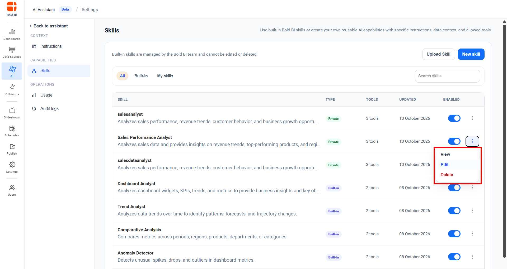

## How Skills Work

When users ask AI Assistant a question:
- If they select a skill, that skill's instructions guide the response
- Selected skills can access their assigned MCP tools for data retrieval
- To access the skill in AI Assistant refer to this page in skill section [Skills](/artificial-intelligence-and-machine-learning/unified-ai-agent/data/)
