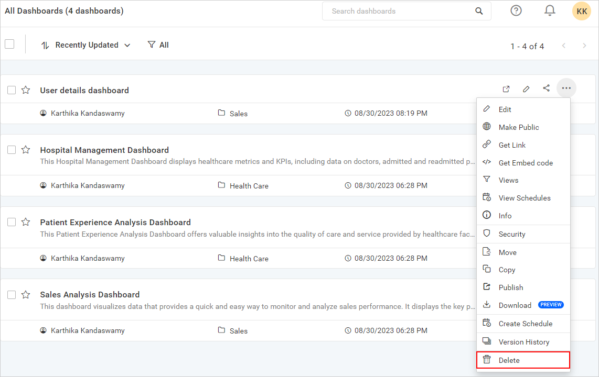

# Deleting a Dashboard from Your Site
Dashboards can also be deleted from the Dashboard server when they are no longer needed.

To delete a Dashboard, click the `Actions` button in the Dashboards grid context menu and select `Delete`.

> **NOTE:**  Dashboards cannot be deleted when they are scheduled by a user.
