# Managing Dashboard Views and Filters

This section explains how to open, add, update, share, delete Dashboard Views, and create schedules with Dashboard Views in Bold BI.
Dashboard Views that are accessible to the user, depending on the user’s permission, are displayed on the Dashboards page.

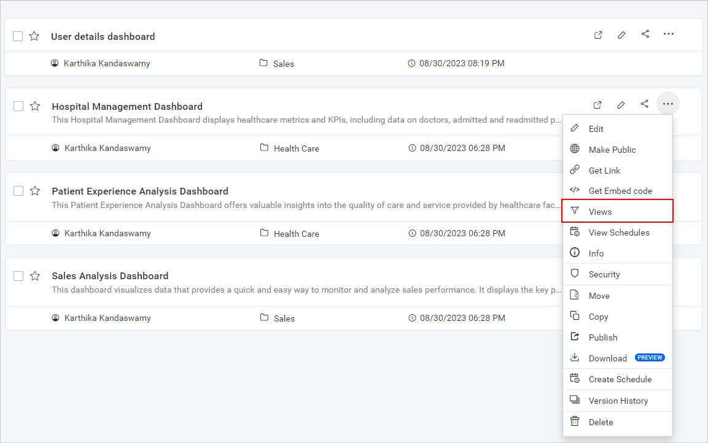

## Open Dashboard Views
Dashboard Views are opened in our embedded Dashboard Viewer itself as Dashboards.

## Add Dashboard Views
* If a user has `Read` access to a dashboard, they can create a Dashboard View in that dashboard.
* A user with only `Read` access to an existing shared Dashboard View can open it and create a new view using the `Save As` option, but cannot update or delete the existing view.
* A user with `Read, Write` access to an existing Dashboard View can update the current view or use the `Save As` option to create a new view.
* A user with `Read, Write, Delete` access can update and delete the Dashboard View.
* The creator of a Dashboard View retains permission to share it. Shared users are granted `Read` access to the view. Delegated `Read, Write` or `Read, Write, Delete` permissions do not grant sharing permission.

### Steps to add a Dashboard View

1. Filters applied in the dashboards are summarized in the `Filter Overview` section under `Applied Filters`.

    To save the filters, click on the `Save` icon. A popup will open to type the name for the Dashboard View and submit it.

    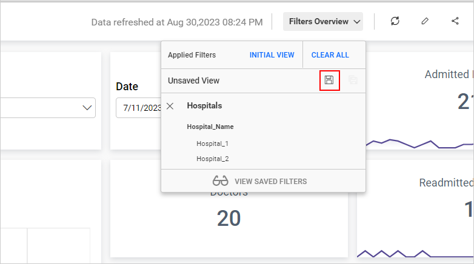    
    
    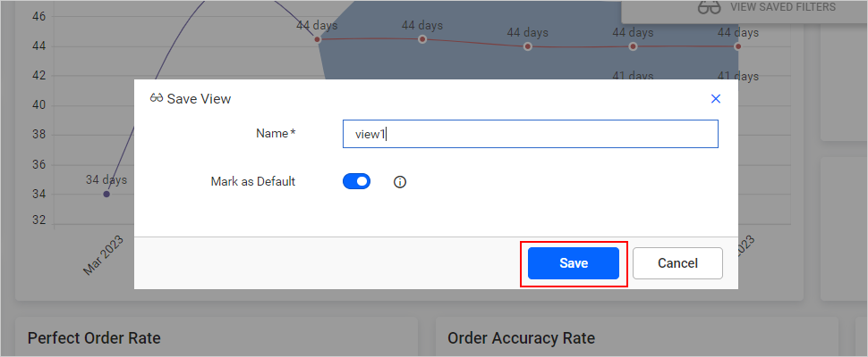

2. The views can be set as default while saving them by enabling the `Mark as Default` option in the save view dialog. Learn more about [Default Views](/site-administration/dashboard-settings/default-views/).

3. Saved Dashboard Views are shown in the Dashboard Views panel by clicking the `Views` icon.

   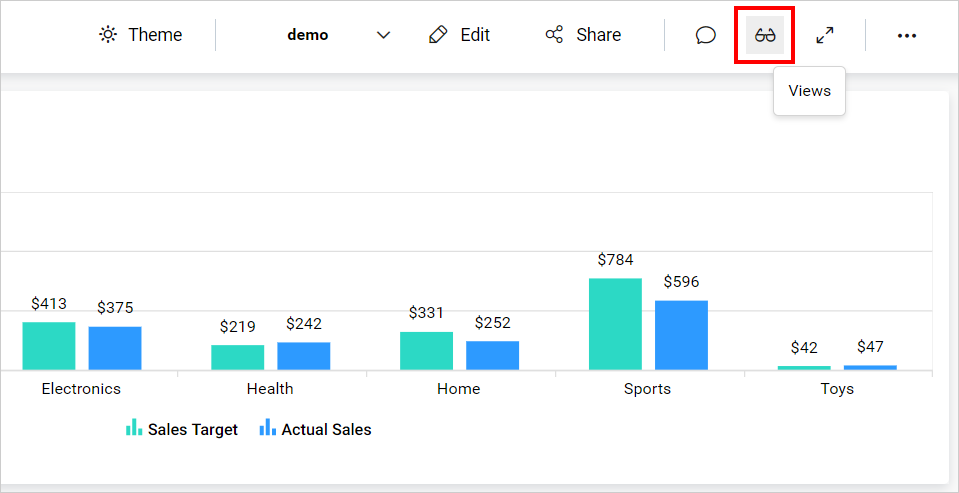
  
   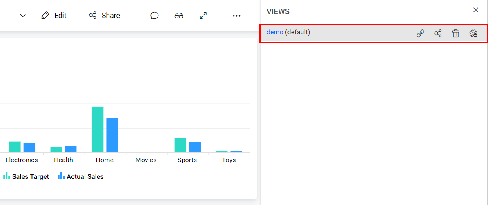

4. Click on the `saved views` shown in the Dashboard Views panel to display the filters applied in that view as an accordion.
   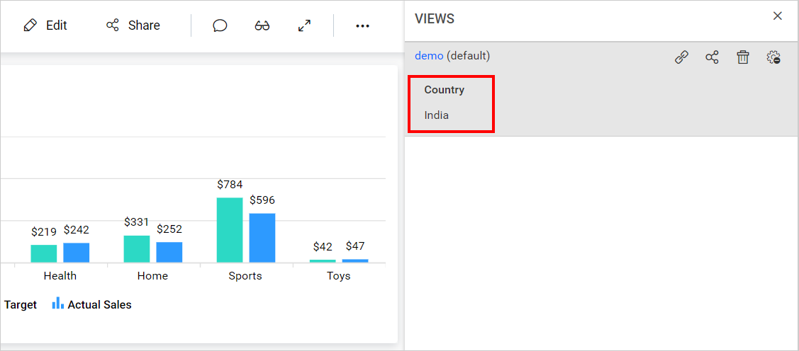

> **NOTE:**
> 1. The `Read`, `Read, Write`, and `Read, Write, Delete` permissions for Dashboard Views are assigned from [Manage Permissions](/managing-resources/manage-dashboards/manage-dashboard-views/#dashboard-view-permission).
> 2. Refer to this [link](/visualizing-data/working-with-widgets/saving-user-interacted-widgets/) to configure and save the `Interaction Widgets` to `Dashboard Views`.

## Dashboard View Permission

The access mode determines the actions available for an existing Dashboard View:

<table>
<tr>
<td width = 250px><strong>Access mode</td>
<td><strong>Dashboard View actions</td>
</tr>
<tr>
<td>Read</td>
<td>List, open, and apply saved filters. Save, update, and delete actions are unavailable; Save As remains available where supported.</td>
</tr>
<tr>
<td>Read, Write</td>
<td>List, open, apply the saved filters, and update the current view. Delete is not available.</td>
</tr>
<tr>
<td>Read, Write, Delete</td>
<td>List, open, apply the saved filters, update the current view, and delete the view.</td>
</tr>
</table>

When an editable view is selected and its filters are changed, both **Save** and **Save As** are available. For a read-only view, **Save** is unavailable and **Save As** remains available to an authenticated user who can read the dashboard. Selecting a view refreshes these actions according to the effective permission for that view.

> **NOTE:** Dashboard View permissions do not change the existing restrictions for mobile, slideshow, usage analytics, or embedding modes that do not support saved Dashboard View actions.

### Dashboard View Permission Scopes

The following scopes are available when adding Dashboard View permissions:

* **All Views**, applies to every active Dashboard View in the site. No scope selection is required.

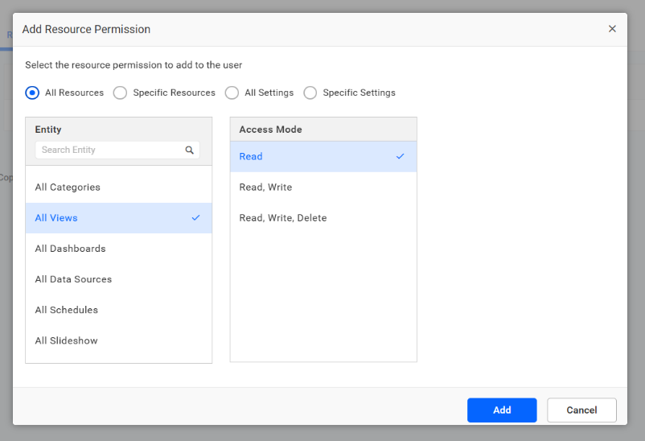

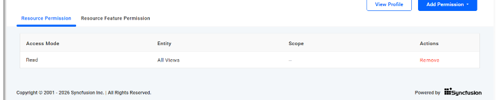

* **Views in Dashboard**, applies to every active Dashboard View under the selected dashboard. Select one or more dashboards from the dashboard tree. This scope applies only to Dashboard Views within dashboards that the user has access to.

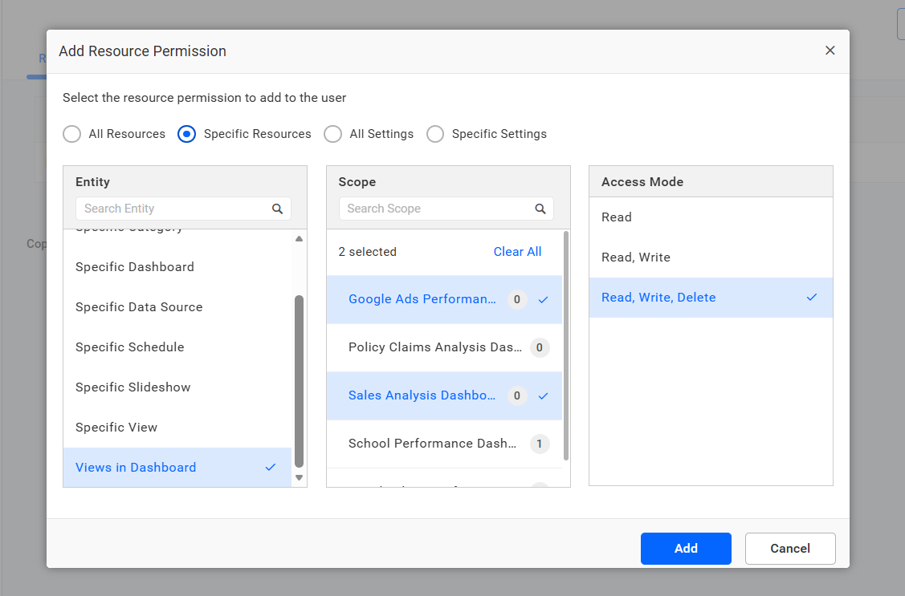

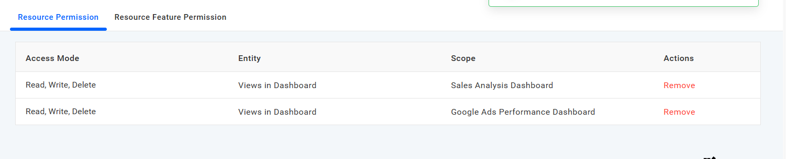

* **Specific View**, applies only to the selected Dashboard Views. Expand a dashboard in the dashboard tree and select one or more views. The user must have access to the parent dashboards of the selected views.

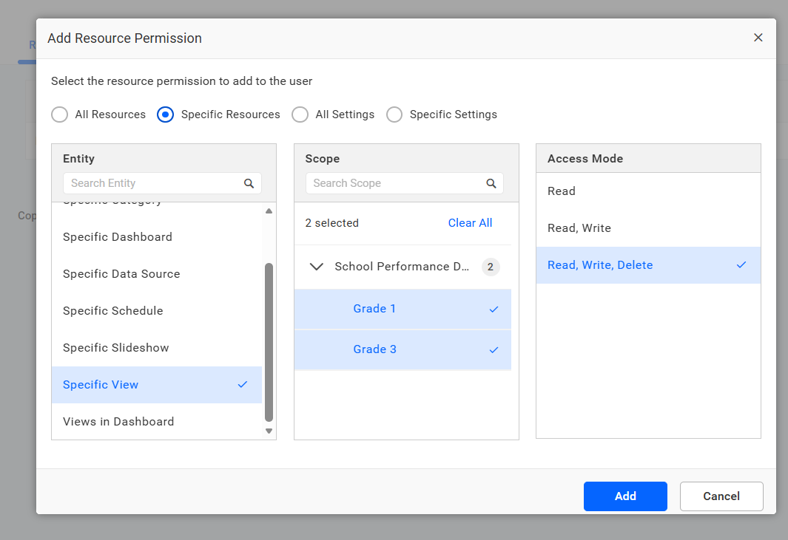

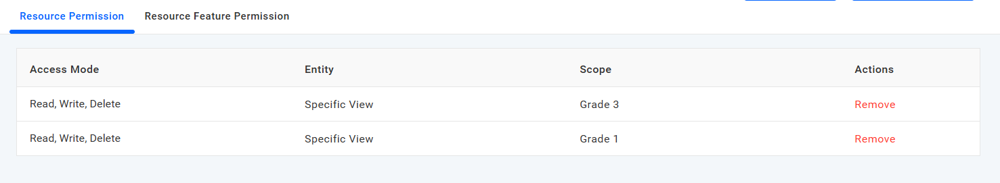

## Create a Schedule with Dashboard Views

Dashboard Views can be scheduled to export content based on time intervals or when certain threshold conditions are met. For more information on utilizing Dashboard Views in dashboard export scheduling, please refer [here] (/managing-resources/manage-schedules/)

## Share Dashboard Views
Dashboard Views can be shared by the user who created the view. Sharing grants access to the Dashboard View based on the assigned Dashboard View permissions. Users must also have the required access to the parent Dashboard to open and use the view.

### Steps to share a Dashboard View

1. Click on the `Share Permissions` option in the Dashboard Views list.

	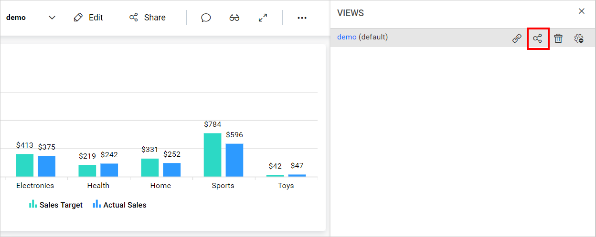

2. Type the username or group name with whom you want to share the `Dashboard View`.

	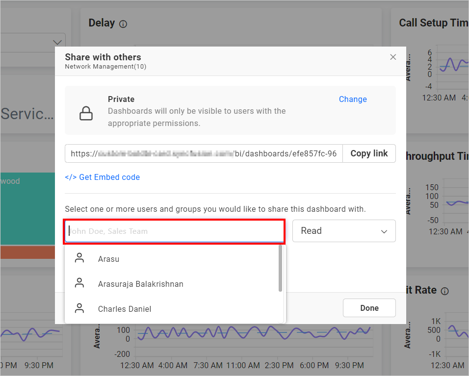

3. After selecting the users or groups, click on `Share`.

	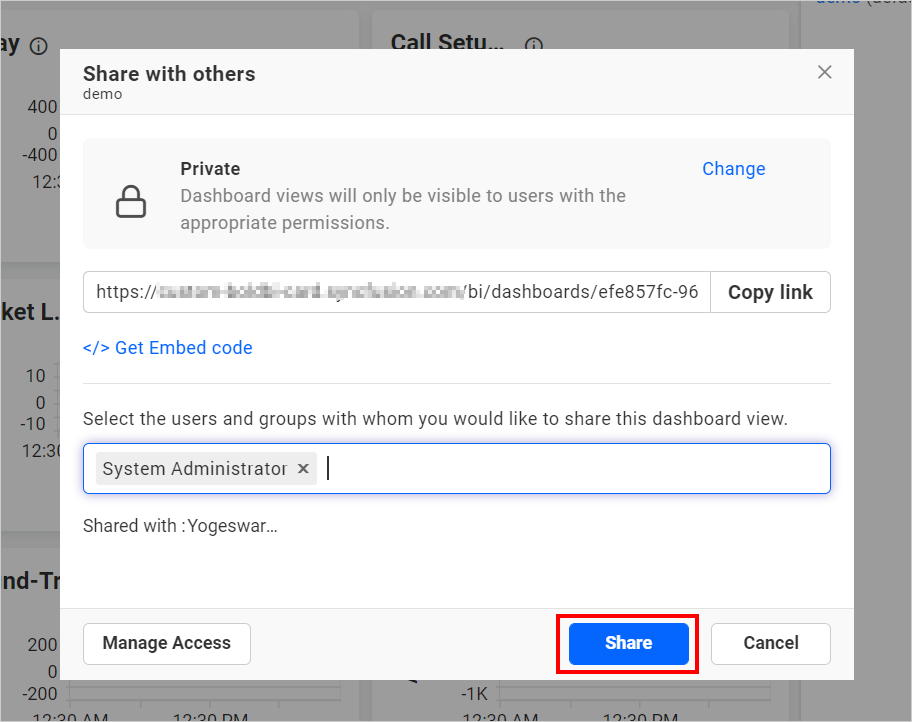
	
> **NOTE:** Only the user who created the Dashboard View can share it with other Bold BI users.

### Remove Permission

Only the user who created the Dashboard View can remove the shared Dashboard View permissions.

1. Click the `Manage Access` button to see the users or groups and their permissions.

	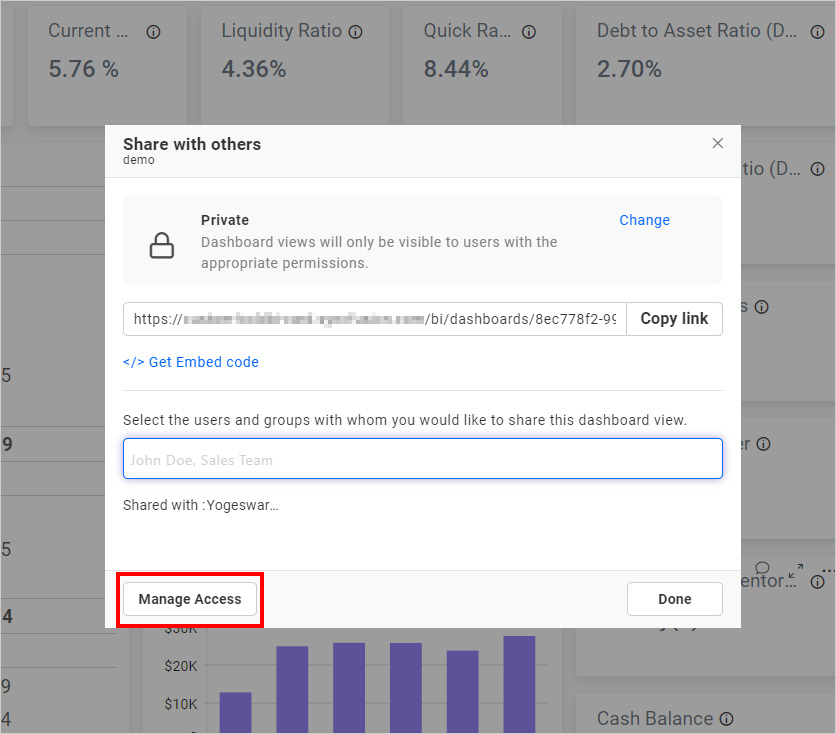

2. Then, remove the permissions using the `Remove` option in the `Actions` column of each permission.

    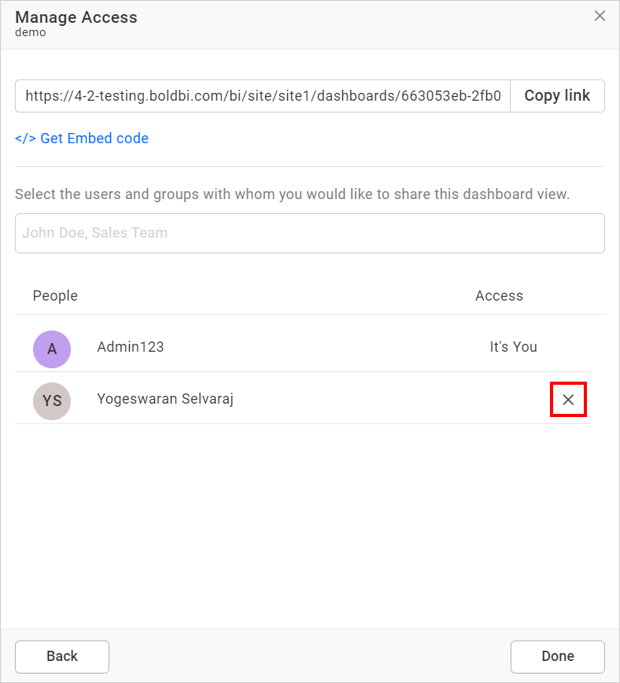
	
## Make Public

Dashboard Views can be marked as public to allow anyone to access it. 

Click the `change` button to select the access permission. 

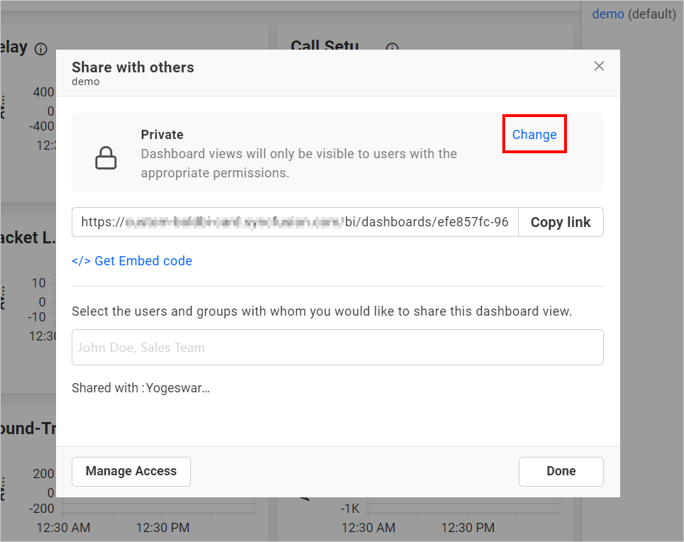

After selecting the access permission, click the `Change` button.

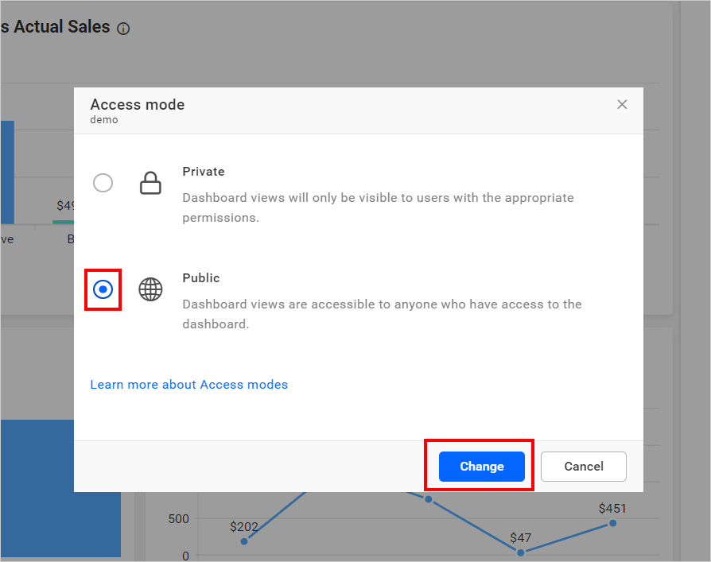
		
## Delete Dashboard Views

Choose the `Delete` option to remove the Dashboard View from Bold BI.

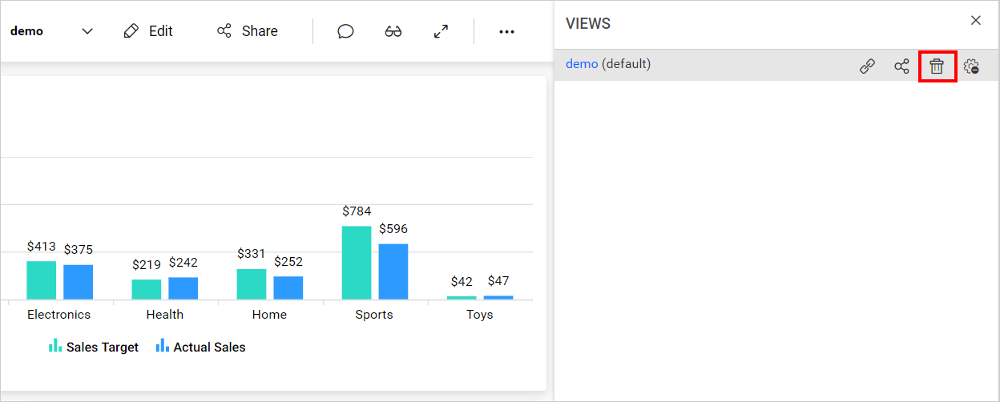

## Set a default view for the dashboard

The Dashboard View can be set as the default view in two ways: while saving the view or from the views list for the dashboard by following these steps:

1. Select any view from the list of available Dashboard Views and click `Set as Default` option.

    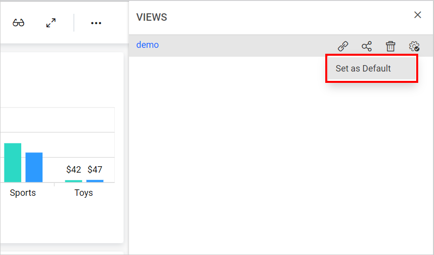

2. If the dashboard has no default views yet and you click the `Set as Default` option, then the respective view will be set as the default view for the dashboard and a success message will be displayed.

    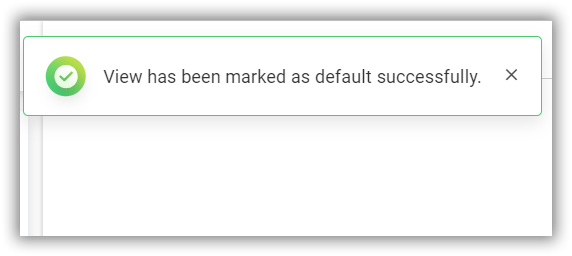

3. If a default view already exists for the dashboard, a confirmation dialog box will be opened and proceed with `Yes`.

    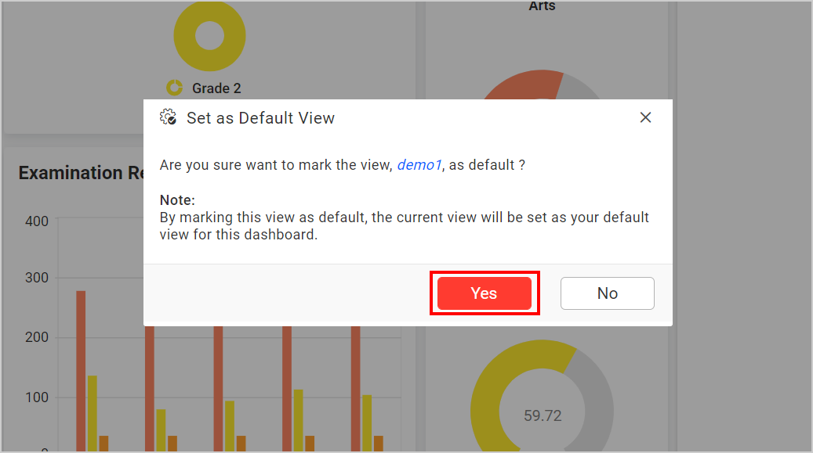

4. After setting the Dashboard View as the default for the dashboard, the text `(default)` will be appended with the respective view in the views listing panel.

    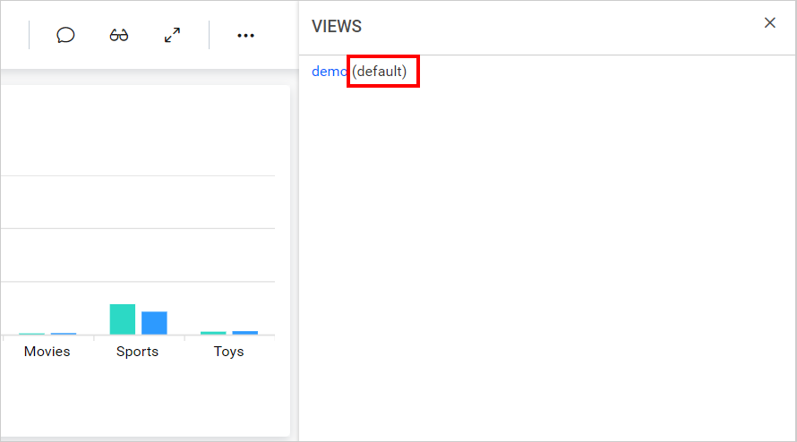

> **NOTE:** To set a Dashboard View as the default view for the dashboard, the `Default view` option in `Dashboard settings` must be enabled. Learn more about [Default Views](/site-administration/dashboard-settings/default-views/).

## Remove a default view for the dashboard

The default view of the dashboard can be removed to view the dashboard with its initial view by following these steps:

1. Click `Remove as Default` option.

    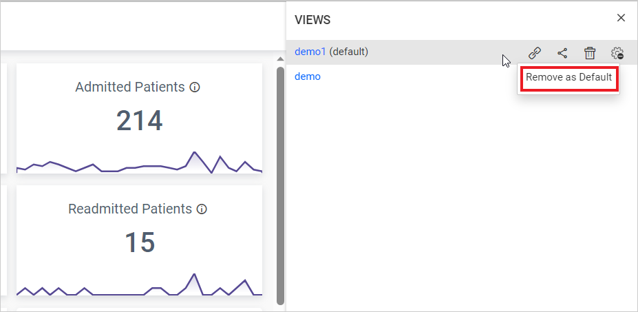

2. Proceed with `Yes` in the opened dialog box.

    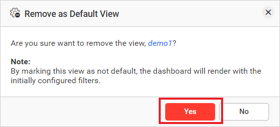
