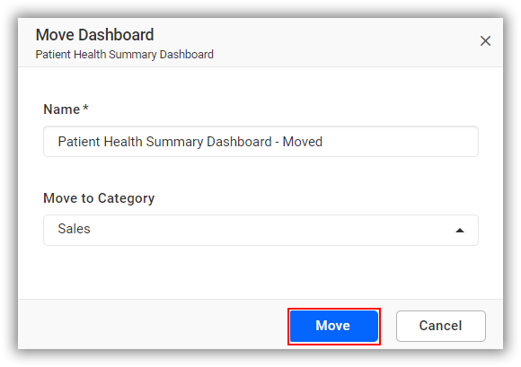
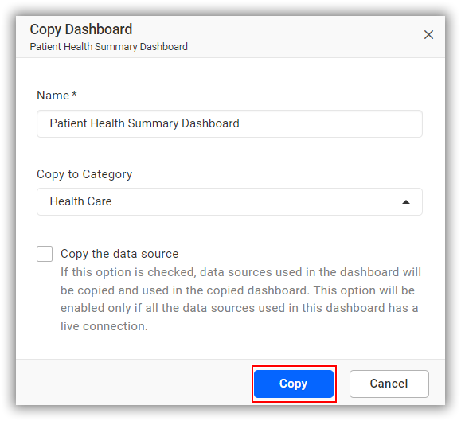

# Move or Copy a Dashboard in Your Site
Dashboards can be moved or copied from one category to another.

### Move Dashboards
Moves the Dashboard from one category to another.

### Copy Dashboards
Copies the Dashboard from one category to another.

