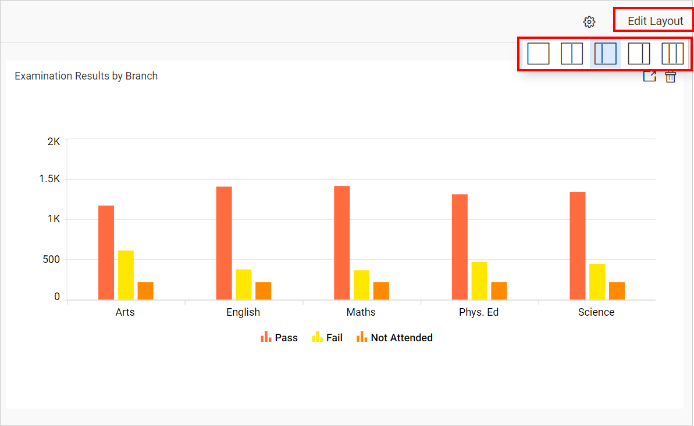

# Editing a Pinboard Layout in Your Site

This section explains how to edit the Pinboard layout in the Bold BI application.

The Pinboard is based on a column layout.

### Steps to edit layout in Pinboard

To change the layout of the Pinboard.

1. Click on the `Edit Layout` option in the Pinboard menu, and then select a new layout from the available options to change the layout of the Pinboard.

    