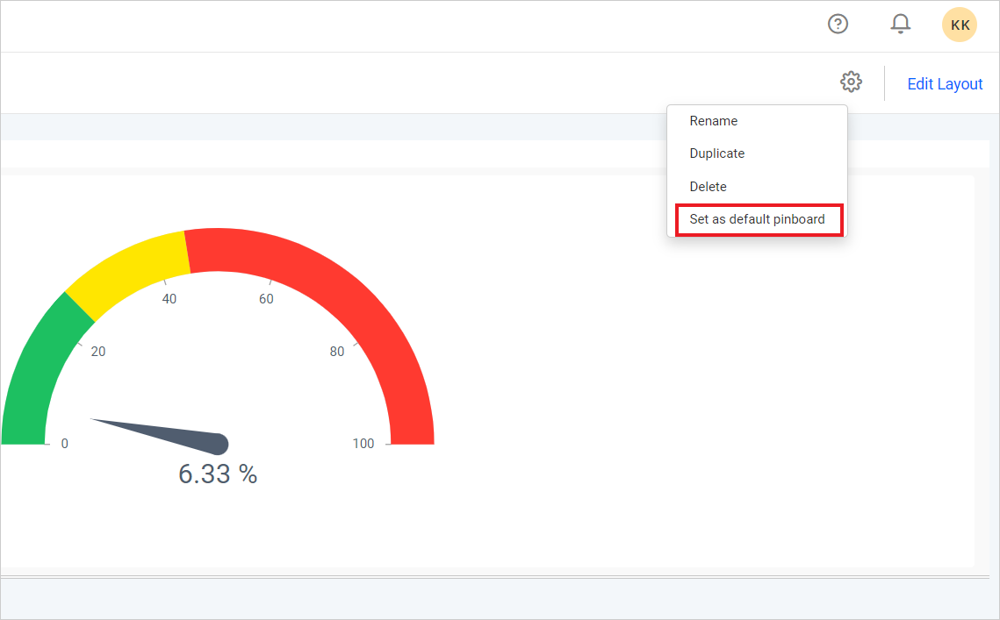

# Setting a Default Pinboard in Your Site

This section explains how to set a default Pinboard in the Bold BI application.

The Default Pinboard will be loaded automatically when the user navigates to the Pinboard.

* Click on the `Set as Default Pinboard` option from the `gear` icon menu.

    
