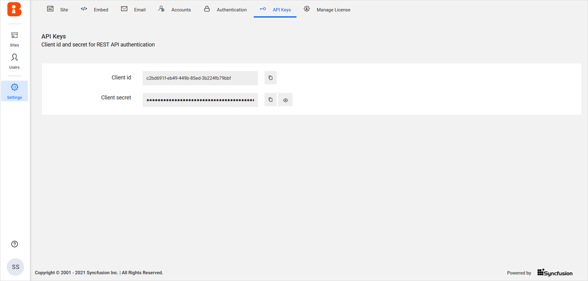

# API Keys

Use the Client Id and secret on this page to authenticate Bold BI REST API calls.

To learn more about calling the REST API, see [Interact with REST API](/server-api-reference/interact-with-rest-api/).

