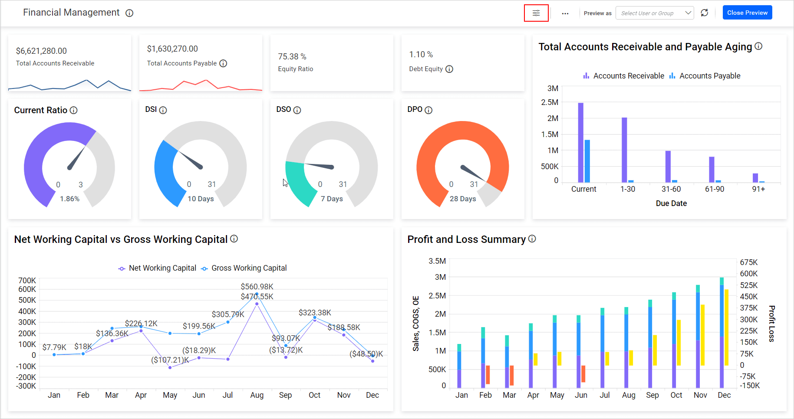
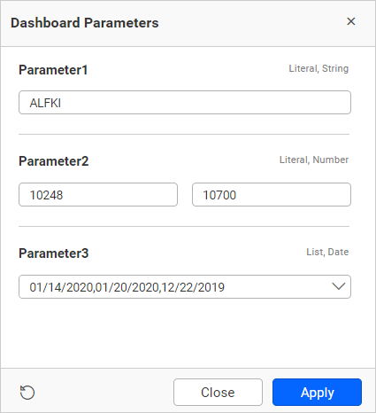

# Change Dashboard Parameter Values Dynamically

To change the dashboard parameter values dynamically, users can update them in view mode.

Click on the dashboard parameter icon to make changes.

Now, the list of added parameters will be displayed in the following dialog.

You can change the values and click `Apply` to render the dashboard based on the updated value.