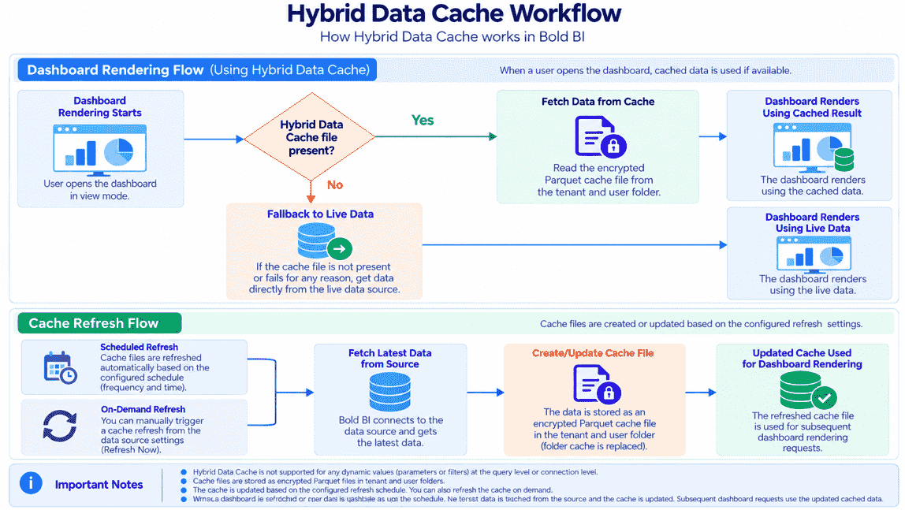
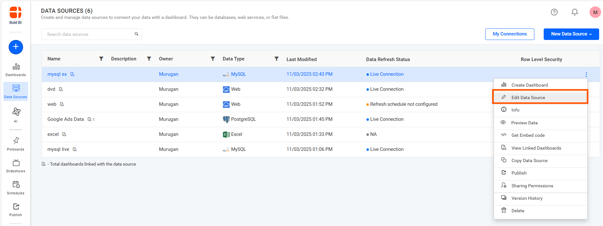
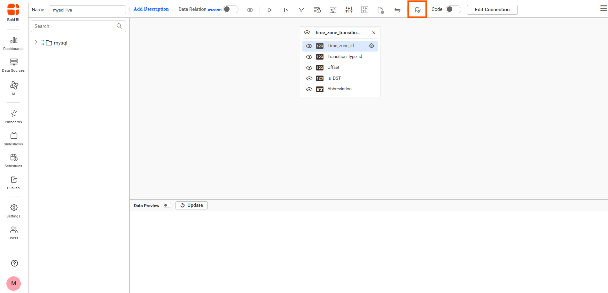
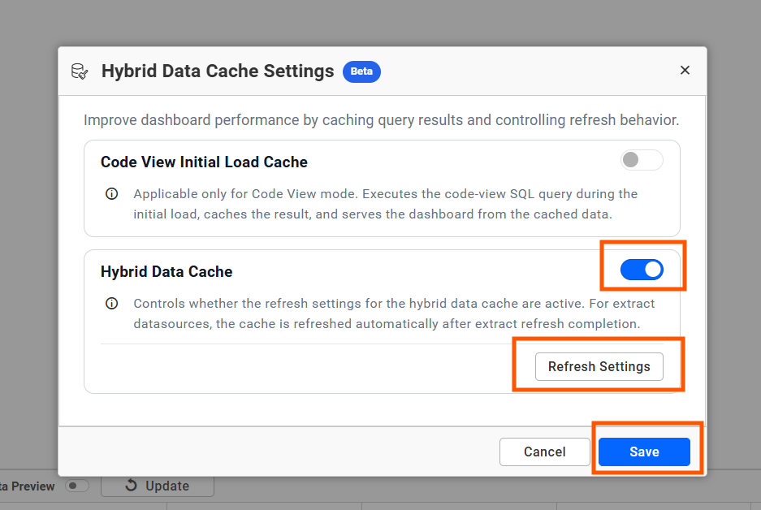
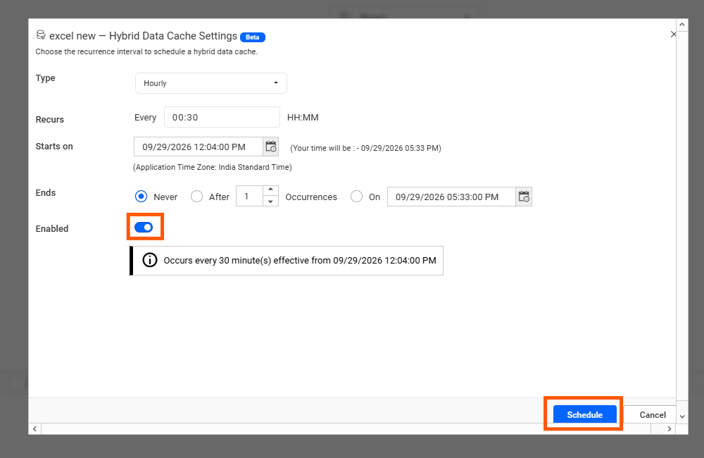
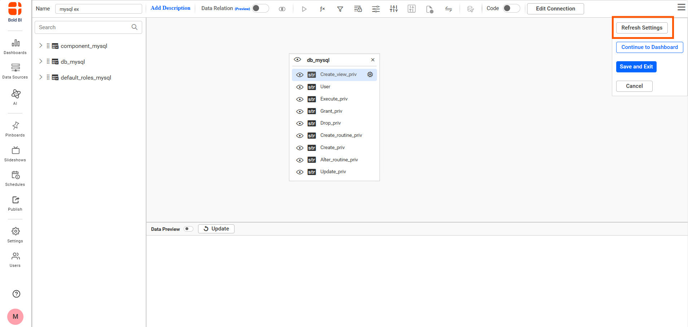
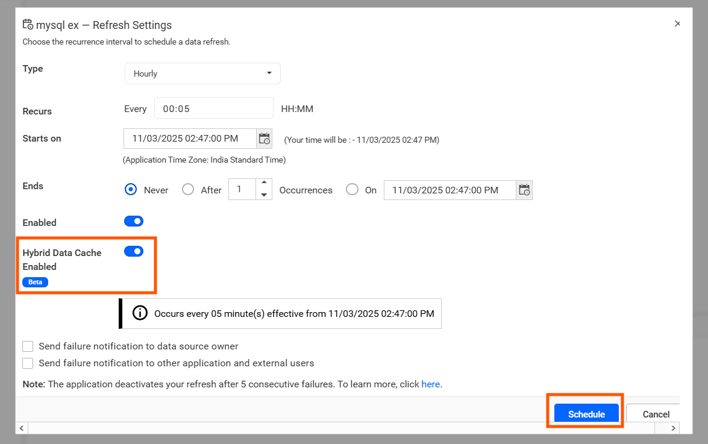
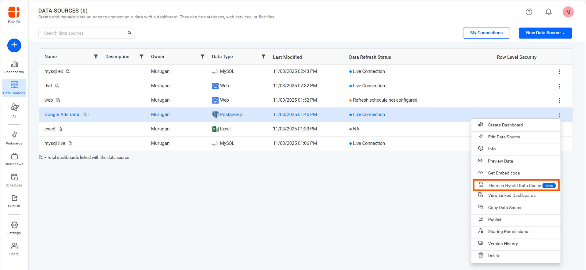
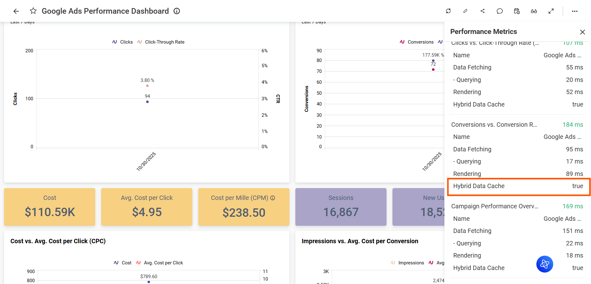

# Hybrid Data Cache for Data Sources in Bold BI

The **Hybrid Data Cache (Beta)** option creates an encrypted reusable cache for supported data sources. Dashboards can use this cache during view mode instead of repeatedly querying the original data source.

### Hybrid Data Cache workflow

   

> **NOTE:** Hybrid Data Cache is supported only for on-premises deployments. Cached data is used during dashboard view mode.
## Prerequisites

Before configuring Hybrid Data Cache, make sure that:

1. The data source is one of the supported Live or Extract data sources.
2. The data source is saved after updating the cache settings.

## Availability

| Data source mode | Hybrid Data Cache behavior |
|---|---|
| Live mode | The Hybrid Data Cache option is displayed in the Hybrid Data Cache Settings dialog. Refresh Settings are enabled when Hybrid Data Cache is turned on. |
| Extract mode | The Hybrid Data Cache option and independent Refresh Settings are hidden in the dialog. Cache generation follows the Extract refresh workflow. |

## Hybrid Data Cache Configuration

The **Hybrid Data Cache** option controls whether Bold BI creates and uses an encrypted cache for the data source.

For Live data sources, Hybrid Data Cache can be refreshed based on the configured cache refresh schedule.

For Extract data sources, Hybrid Data Cache follows the Extract refresh workflow. After a scheduled or manual Extract refresh is completed successfully, Bold BI triggers Hybrid Data Cache processing based on the Extract refresh flow. The Hybrid Data Cache option and independent cache refresh schedule are not shown in the Extract mode settings dialog.

## Live Mode Configuration

To configure Hybrid Data Cache for a Live mode data source:
1. Navigate to the **Data Sources** list page.
2. Create a new data source or select an existing data source and click **Edit Data Source**.

   

3. Click the **Hybrid Data Cache** icon in the data source designer toolbar.

   

4. Enable **Hybrid Data Cache**.

   

5. Click **Refresh Settings**.
6. Configure the required cache refresh schedule.
7. Click **Schedule** to save the refresh configuration.
8. Click **Save** in the Hybrid Data Cache Settings dialog.
9. Save the data source.

### Refresh Settings

The **Refresh Settings** button is enabled only when **Hybrid Data Cache** is enabled.

Use Refresh Settings to configure how frequently the Hybrid Data Cache should be refreshed. The supported recurrence options include:

1. Hourly
2. Daily

The schedule configuration also includes options for recurrence interval, start date and time, end conditions, and application time zone.



## Extract Mode Configuration

For Extract mode data sources, the Hybrid Data Cache Settings dialog displays only the **Code View Initial Load Cache** option.

For Extract data sources:

1. The **Hybrid Data Cache** option is hidden.
2. A separate Hybrid Data Cache schedule is not required.
3. Hybrid Data Cache refresh follows the Extract data refresh workflow.
4. After a scheduled or manual Extract refresh is completed successfully, Hybrid Data Cache processing is triggered based on the Extract refresh flow.

The Extract mode cache workflow is:

1. Extract data source refresh starts.
2. Extract refresh completes successfully.
3. Hybrid Data Cache generation starts based on the completed Extract refresh flow.
4. The dashboard uses the generated cache during view mode.

3. If your data source is in **Extract Mode**, click **Refresh Settings** and enable the **Hybrid Data Cache** option.

    

   

4. After making your selections, click **Schedule** and save data the source.

## Save and Cancel Behavior

The Hybrid Data Cache Settings dialog keeps the latest saved values while editing the data source.

### Save

When you modify the settings and click **Save**:

1. The latest settings are kept in the current data source editing session.
2. Reopening the dialog displays the latest saved dialog values.
3. The settings are permanently stored only after the data source is saved.

### Cancel

When you modify a setting and click **Cancel**:

1. Changes made after the previous dialog save are discarded.
2. Reopening the dialog restores the previously saved dialog values.

## On-Demand Cache Refresh

After Hybrid Data Cache is configured and the data source is saved, the **Refresh Hybrid Data Cache** option is available from the Data Sources list page for supported configured data sources.

Use this option to manually trigger Hybrid Data Cache generation without waiting for the next scheduled refresh.



> **NOTE:** For Extract data sources, Hybrid Data Cache can also be triggered automatically after a scheduled or manual Extract refresh is completed successfully.

## Sample Dashboard Configuration

Hybrid Data Cache can also be configured for a sample dashboard.

To configure the feature for a sample dashboard:

1. Save the sample data source.
2. Edit the saved data source.
3. Open **Hybrid Data Cache Settings**.
4. Configure the required cache option.
5. Save the Hybrid Data Cache settings.
6. Save the data source again.
7. Publish the dashboard.

The configured cache settings are then reflected during dashboard rendering.

## Dashboard View

After the Hybrid Data Cache is generated, open the dashboard in view mode.

The dashboard can use the generated Hybrid Data Cache instead of repeatedly querying the original data source. You can verify Hybrid Data Cache usage from the **Metrics Details** section.

When a widget is rendered using Hybrid Data Cache, the metrics information displays:

```text
Hybrid Data Cache: True
```



## Cache Performance Metrics

Hybrid Data Cache is generated based on the configured refresh schedule. Because the data is already moved to the cache before the dashboard is viewed, dashboard rendering can use the cached data without waiting for the source database query to complete.

The following table uses illustrative timings to show example cache performance.

| Metric | Before Cache (Live Data) | After Cache (Cache Enabled) | Time Reduction (%) |
|---|---|---|---|
| Total Load Time | 4.840 sec | 1.210 sec | 75.00% |
| Query Execution Time | 4.093 sec | 0.900 sec | 78.01% |
| Query Preparation Time | 0.213 sec | 0.043 sec | 79.81% |
| Data Post-Processing Time | 0.034 sec | 0.31 sec | No changes |

## Cache Creation and Storage

Hybrid Data Cache uses encrypted Parquet files to store cached data.

Cache generation time depends on the data set size and deployment environment. Large data sets can take additional time before the cached data becomes available to the dashboard.

Parquet-based storage can also reduce the storage size compared with the original uncompressed data size.

## Supported Data Sources

Hybrid Data Cache is supported for applicable Live and Extract workflows, including:

1. SQL Server Live and Extract
2. PostgreSQL Live and Extract
3. MySQL Live and Extract
4. Supported Extract workflows that use intermediate data processing, such as:
   - Snowflake Extract
   - CSV
   - Excel
   - Google Sheets
   - Web API Extract
   - SharePoint
   - Other supported Extract connectors

## Limitations

1. Support is limited to compatible data sources and intermediate processing workflows.
2. Cache generation time depends on the data set size and deployment environment.
3. Hybrid Data Cache is supported only for on-premises deployments. The cached data is used during dashboard view mode.
4. To activate, enable the hybrid data cache option in the data source
Code view mode with dynamic parameters (dashboard parameters and custom attributes) is not supported
