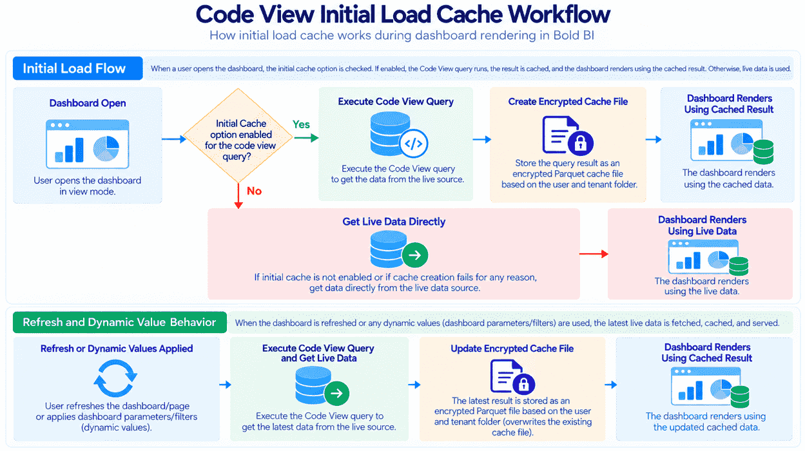
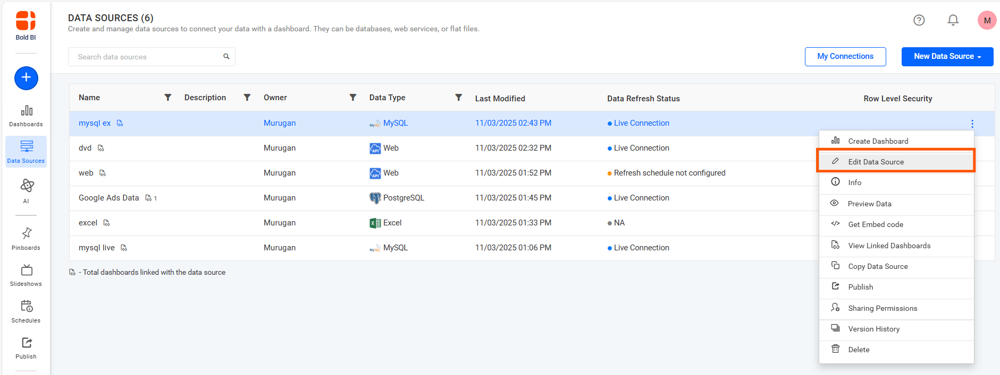
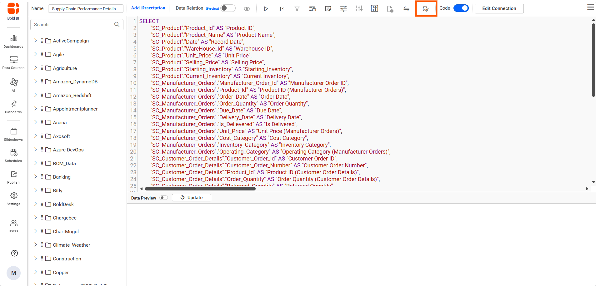
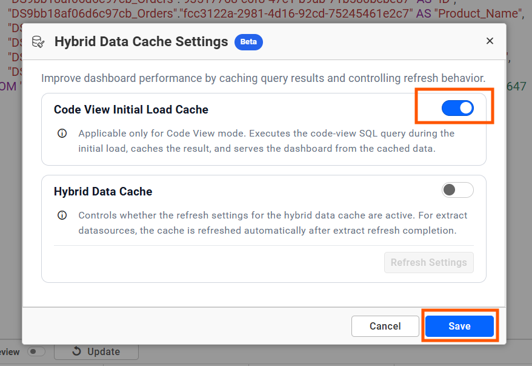
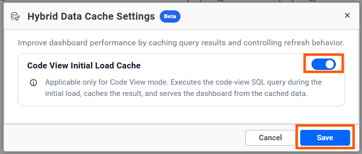
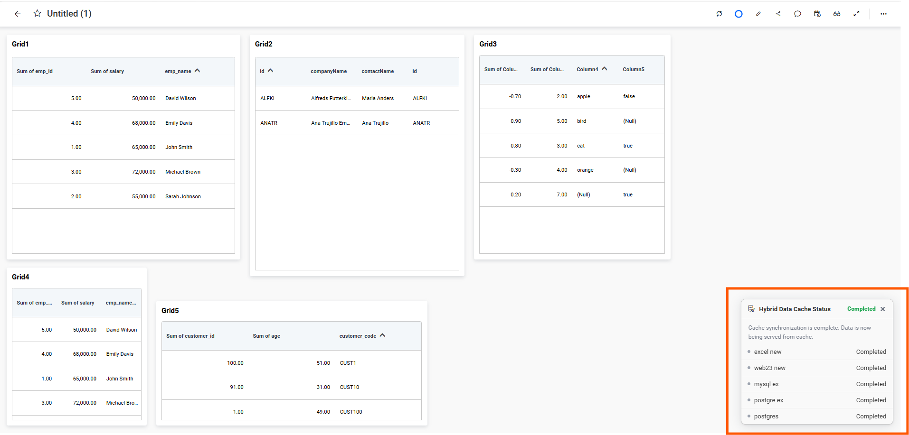
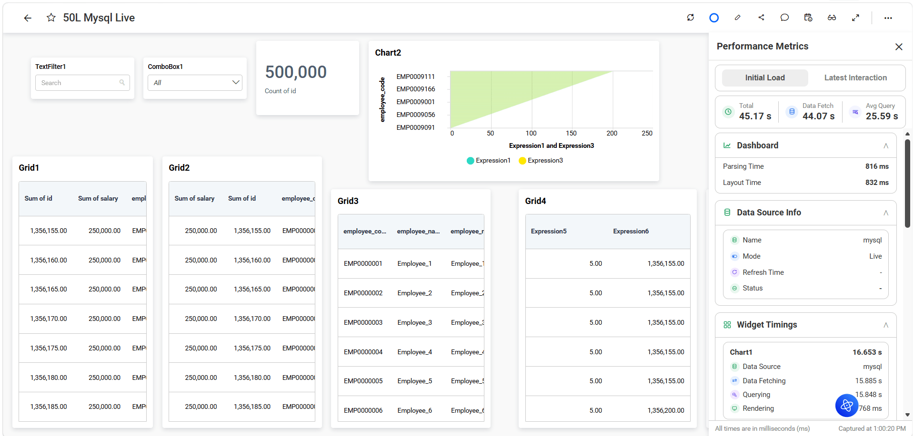
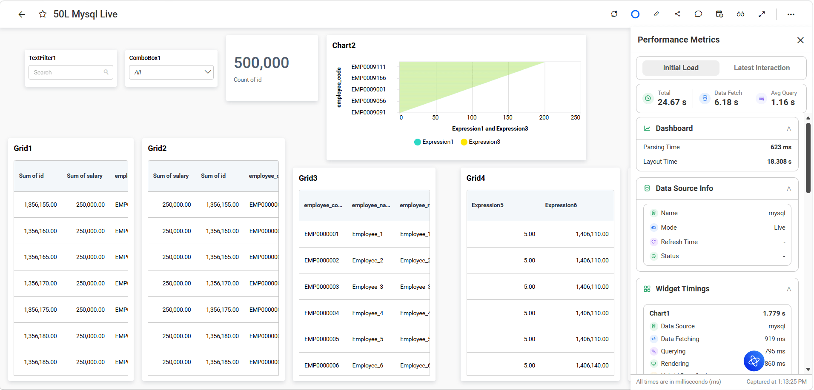

# Initial Load Cache for Data Sources in Bold BI

> **Note:** The Code View Initial Load Cache is available in Bold BI from v17.1.30 onwards. It runs the SQL query when the dashboard loads and stores the result in encrypted local storage, using the existing Hybrid Data Cache.

The **Code View Initial Load Cache** option caches the result of a Code View query during the initial dashboard load. After the cache is created, the server can use the cached result for subsequent supported dashboard requests instead of executing the same query against the source database.

### Code View Initial Load Cache workflow
   

> **NOTE:** Code View Initial Load Cache is available only when the data source query is configured in Code View mode.

## Configure Code View Initial Load Cache

To enable Code View Initial Load Cache:
1. Navigate to the **Data Sources** list page.
2. Create a new data source or select an existing data source and click **Edit Data Source**.

   

2. Make sure the query is configured in **Code View** mode.
3. Click the **Hybrid Data Cache** icon in the data source designer toolbar.

   
   
4. Enable **Code View Initial Load Cache**.

   

5. Click **Save** in the dialog.
6. Save the data source.
7. Open the dashboard in view mode.

### Code View mode

When the query is configured in Code View mode:

1. The **Code View Initial Load Cache** option is available.
2. You can enable or disable the option based on the dashboard requirement.
3. When enabled, the query result from the initial load is cached.

   For Live mode datasource

      
   For Extract mode datasource
      

### Table mode

When the data source is configured in Table mode:

1. The **Code View Initial Load Cache** option is disabled.
2. The option cannot be enabled or modified.
3. Initial Load Cache is not applied to Table mode queries.

### Initial Load Cache Confirmation

When **Code View Initial Load Cache** is enabled, the Code View query is executed during the initial load and the query result is moved to the cache.

After the cache is successfully generated and made available for dashboard rendering, a confirmation notification is displayed for 10 seconds to indicate that the cache is ready for use.

   

The server then uses the cached data for subsequent supported dashboard requests instead of executing the same query against the source database.

## Query Mode Behavior

| Query mode | Code View Initial Load Cache behavior |
|---|---|
| Code View | The option is available and can be enabled or disabled. |
| Table mode | The option is disabled and cannot be modified. |

## Cache Performance Metrics

The following dashboard performance comparison shows the initial load difference before and after enabling cache.

Before Initial Load Cache

After Initial Load Cache

| Metric | Before Cache (Live Data) | After Cache (Cache Enabled) | Improvement |
|---|---|---|---|
| Total Load Time | 45.17 sec | 24.67 sec | 45% Faster |
| Data Fetch Time | 44.07 sec | 6.18 sec | 86% Reduction |
| Average Query Time | 25.59 sec | 1.16 sec | 95% Reduction |
| Layout Time | 832 ms | 18.30 sec* |  |

*Layout time now represents the majority of the loading duration because backend data retrieval is completed significantly faster.

Use **Total Load Time**, **Data Fetch Time**, and **Average Query Time** to verify the cache improvement.

## Cache Creation and Storage

Data Cache uses encrypted Parquet files to store cached data.

Cache generation time depends on the data set size and deployment environment. Large data sets can take additional time before the cached data becomes available to the dashboard.

Parquet-based storage can also reduce the storage size compared with the original uncompressed data size.

## Supported Data Sources

Initial Load Cache is supported for applicable Live and Extract workflows, including:

1. SQL Server Live and Extract
2. PostgreSQL Live and Extract
3. MySQL Live and Extract
4. Supported Extract workflows that use intermediate data processing, such as:
   - Snowflake Extract
   - CSV
   - Excel
   - Google Sheets
   - Web API Extract
   - SharePoint
   - Other supported Extract connectors

## Limitations

1. Code View Initial Load Cache is applicable only to Code View mode.
2. Code View queries that use custom attributes are not supported.
3. Compatible with SQL, Live, MySQL Live Connector, and intermediate databases
3. Cache generation time depends on the data set size and deployment environment.
4. Code View Initial Load Cache supports both on-premises and cloud deployments, The cached data is used during dashboard view mode.
