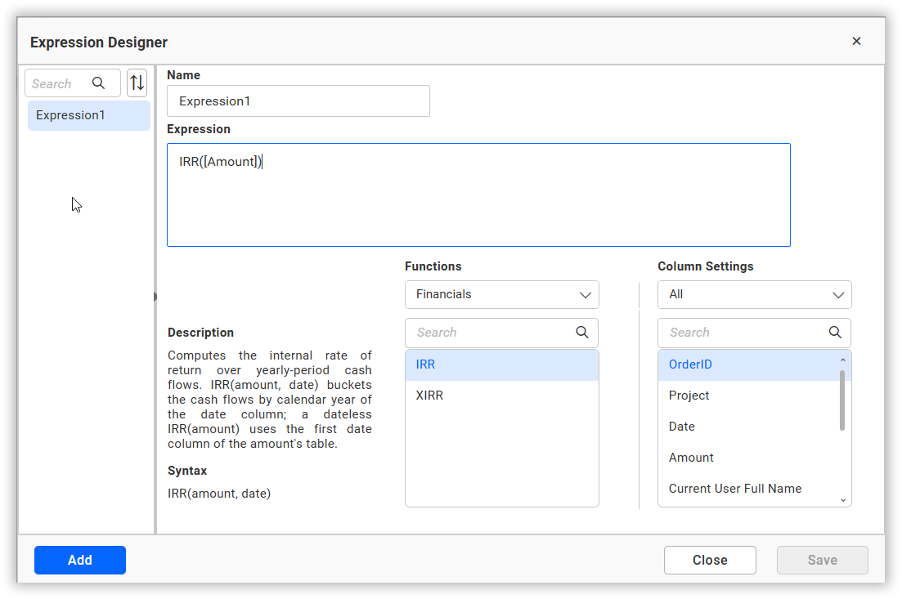
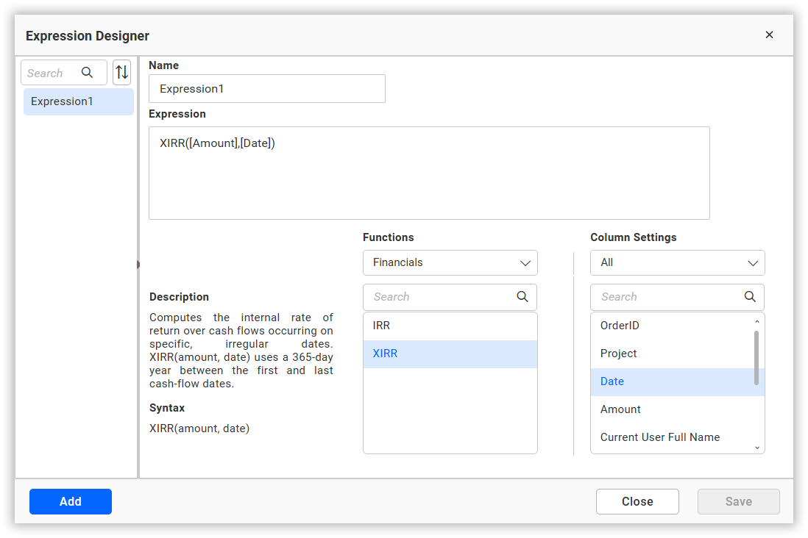
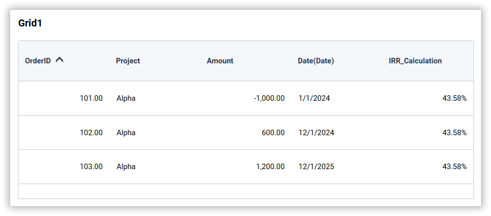
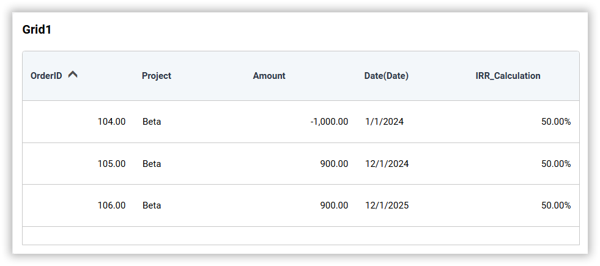
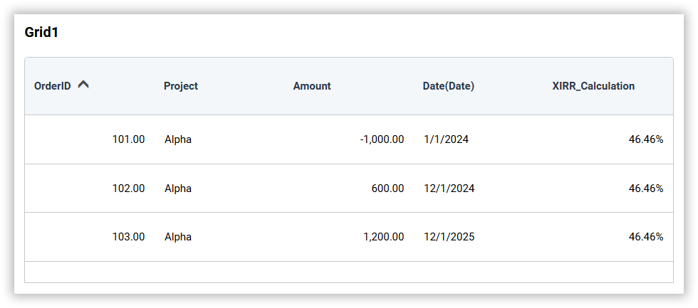

# Configure Financial Expressions in Bold BI

Financial expressions allow you to compute the internal rate of return (IRR) over the cash-flow data in your data source. The rate is calculated at the point where the net present value of the cash flows becomes zero. The value is computed by the Bold BI service from the underlying data of the data source, so the result is not affected by the number of rows displayed in the widget.

## Financial expression syntax

A financial expression has the following structure:

```format
IRR | XIRR(<amount>, <date>)
```
### [IRR | XIRR]

#### IRR

IRR expressions treat each distinct date value in the data as one consecutive period, ordered chronologically by the date column. The calculation is performed on the cash flows of the amount column, and the resulting rate is returned as the expression value.

```format
Example: IRR([Amount], [Date])
```

For more information about IRR expressions, and for some example IRR scenarios, see the [IRR](/working-with-data-sources/data-modeling/configuring-expression-columns/financial-expressions/###IRR) section.

#### XIRR

XIRR expressions use the actual dates of the cash flows and a 365-day year to weight each amount by the time elapsed since the first cash flow. The resulting rate is returned as the expression value.

```format
Example: XIRR([Amount], [Date])
```

For more information about XIRR expressions, and for some example XIRR scenarios, see the [XIRR](/working-with-data-sources/data-modeling/configuring-expression-columns/financial-expressions/###XIRR) section.

### \<amount\>
The amount expression is the numeric column that contains the cash flows. Negative amounts represent investments (money paid out) and positive amounts represent returns (money received).

- IRR: [Amount]

- XIRR: [Amount]

### \<date\>
The date column specifies the column that orders the cash flows.

- [Date]

For XIRR, this argument is mandatory and must be a date column. For IRR, this argument is optional; when omitted, IRR uses the first date column of the table that contains the amount column.

## Creating a financial expression

A financial expression is created in the same way as any other data source expression column. Click `Add` in the `Query Expressions` window, enter a suitable name for the expression in the `Name` text area, and type the financial expression in the Expression text area. For more information, refer to [Adding an expression column](/working-with-data-sources/data-modeling/configuring-expression-columns/###adding-an-expression-column).

The financial functions are available in the **Financials** category of the `Functions` section, and the columns of the data source are listed in the `Columns` section. To create an IRR expression, enter the name, type the IRR expression with the amount and date columns, and click `Save`.



Similarly, to create an XIRR expression, select the XIRR function or type the XIRR expression with the amount and date columns, and click `Save`.



## Types of financial expressions

- IRR
- XIRR

### Sample Data

<table>
    <tr>
        <th>OrderID</th>
        <th>Project</th>
        <th>Date</th>
        <th>Amount</th>
    </tr>
    <tr>
        <td>101</td><td>Alpha</td><td>"2024-01-01"</td><td>-1000.00</td>
    </tr>
    <tr>
        <td>102</td><td>Alpha</td><td>"2024-12-01"</td><td>600.00</td>
    </tr>
    <tr>
        <td>103</td><td>Alpha</td><td>"2025-12-01"</td><td>1200.00</td>
    </tr>
    <tr>
        <td>104</td><td>Beta</td><td>"2024-01-01"</td><td>-1000.00</td>
    </tr>
    <tr>
        <td>105</td><td>Beta</td><td>"2024-12-01"</td><td>900.00</td>
    </tr>
    <tr>
        <td>106</td><td>Beta</td><td>"2025-12-01"</td><td>900.00</td>
    </tr>
</table>

### IRR

IRR expressions treat each distinct date value in the data as one consecutive period, ordered chronologically by the date column. Rows that share the same date are combined into a single period by summing their amounts, and rows where the amount is NULL are ignored.

**Example**

The following IRR expression computes the internal rate of return of the cash flows per date:

```format
IRR([Amount], [Date])
```

With Project in the view, a separate rate is computed for the cash flows of each project, and the rate is repeated on every row of the group.

For the project Alpha, the cash flows -1000, 600 and 1200 are treated as three consecutive periods, and the IRR expression returns 0.4358 (43.58%).



For the project Beta, the cash flows -1000, 900 and 900 are treated as three consecutive periods, and the IRR expression returns 0.5 (50%).



When the date argument is omitted, `IRR([Amount])` uses the first date column of the table that contains the amount column.

IRR returns (Null) when the data does not contain at least two cash flows, or when the cash flows do not include at least one positive amount and one negative amount.

### XIRR

XIRR expressions use the actual dates of the cash flows and a 365-day year to weight each amount by the time elapsed since the first cash flow. The rows are sorted chronologically by the date column, rows that share the same date are combined into a single period by summing their amounts, and rows where the amount is NULL are ignored.

**Example**

The following XIRR expression computes the internal rate of return using the actual dates:

```format
XIRR([Amount], [Date])
```

With Project in the view, a separate rate is computed for the cash flows of each project.

For the project Alpha, the returns occur 335 and 700 days after the investment, and the weighted rate returns 0.4646 (46.46%).



For the project Beta, the returns occur 335 and 700 days after the investment, and the weighted rate returns 0.5385 (53.85%).


IRR treats the cash flows as consecutive periods and ignores the number of days between them, while XIRR weights each amount by the actual number of days using a 365-day year. This is why the two functions return different rates for the same data.

XIRR returns (Null) when the data does not contain at least two cash flows on distinct dates, or when the cash flows do not include at least one positive amount and one negative amount.

## Limitations

- IRR and XIRR expressions are computed by the Bold BI service and are not translated into database SQL.
- IRR and XIRR expressions must be the entire expression. They cannot be nested inside another function or combined with other expressions; for example, `ABS(IRR([Amount], [Date]))` and `IRR([Amount], [Date]) * 100` are not supported.
- IRR and XIRR expression columns cannot be used as filter columns, since the value is computed by the service and does not exist in the underlying data. Use the amount or date columns to filter instead.
    - The column is not available in the data filter list of the query designer page.
    - The column is not available in the condition filter and rank filter lists of the dimension filter.
    - If a filter is applied on the expression column, the warning message `Filter is not supported for this expression.` is displayed.
    - The column is not supported in the master-slave filter configuration.
- IRR and XIRR expression columns are not available in the field-based sorting list.
- The data used to compute the rate is limited. If the query fetches more than 500,000 rows, an error message asks you to apply filters or group the data to reduce the number of rows. If a single group contains more than 100,000 cash flows, an error message asks you to apply filters or add more grouping columns.
- XIRR requires the second argument to be a date column. The expression is not valid when the second argument is not a date column.
